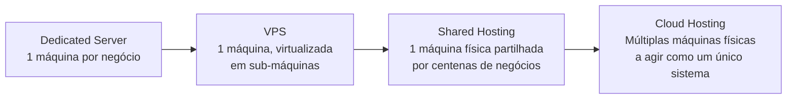
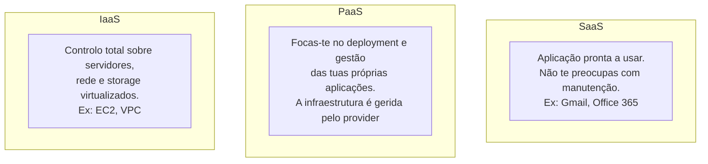
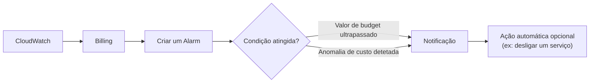

# Aula 1 — Fundamentos de Cloud Computing e AWS Cloud Practitioner

## 📋 Sobre a certificação

**AWS Certified Cloud Practitioner (CLF-C02)** — certificação de nível de entrada.

**Roadmap sugerido para DevOps:**
```
Cloud Practitioner → Solutions Architect Associate → CloudOps Engineer Associate → DevOps Engineer
```

### Formato do exame

| Aspeto | Detalhe |
|---|---|
| Duração | 90 minutos |
| Nº de perguntas | 65 (50 contam para a nota, 15 são de teste/não contam) |
| Tipo de perguntas | Escolha múltipla e resposta múltipla |
| Pontuação para passar | 700 em 1000 |
| Validade da certificação | 3 anos |

### Domínios do exame

| Domínio | Peso |
|---|---|
| 1. Cloud Concepts | 24% |
| 2. Security and Compliance | 30% |
| 3. Cloud Technology and Services | 34% |
| 4. Billing, Pricing and Support | 12% |

### Como estudar
- Ver vídeos das aulas
- Fazer hands-on labs
- Fazer exames de prática online

---

## ☁️ O que é Cloud Computing

> Prática de usar uma rede de servidores remotos alojados na internet para armazenar, gerir e processar dados, em vez de usar um servidor local.

### Evolução do alojamento (hosting)



### O que é um Cloud Service Provider (CSP)

Empresa que fornece múltiplos serviços cloud. Características típicas:

- Os serviços podem ser encadeados entre si
- Acessíveis através de uma API unificada
- Faturação **metered** (pagas pelo que consomes)
- Monitorização integrada
- Oferecem **IaaS** (Infrastructure as a Service)
- Automação via **IaC** (Infrastructure as Code)

**Principais fornecedores:** AWS, Azure, GCP

### Categorias de serviços cloud

- Compute
- Networking
- Storage
- Databases

> A AWS tem mais de 200 serviços disponíveis.

---

## 🧱 Modelos de serviço cloud



| Modelo | O que geres tu | O que é gerido pelo provider |
|---|---|---|
| **IaaS** | SO, runtime, apps, dados | Servidores físicos, virtualização, rede |
| **PaaS** | Apps e dados | SO, runtime, servidores, infraestrutura |
| **SaaS** | Apenas a utilização | Tudo (a app já vem pronta a usar) |

---

## 🌍 Modelos de deployment

- **Public cloud** — infraestrutura partilhada, gerida por um provider (ex.: AWS)
- **Private cloud** — infraestrutura dedicada a uma única organização
- **Hybrid cloud** — combinação de cloud pública e privada
- **Cross/Multi cloud** — utilização de múltiplos providers cloud em simultâneo

---

## 🔐 IAM — primeiros passos

- Criar **utilizadores** e **grupos** no IAM (ex.: grupo `admin` com *Administrator Access*)
- **Nunca usar a conta root** para tarefas do dia a dia — usar sempre utilizadores IAM

---

## 🌎 Regiões

Uma **região** é uma área geográfica onde a AWS tem infraestrutura. Os recursos são criados dentro de uma região específica.

---

## 💰 Billing e controlo de custos

> O custo é sempre proporcional ao que consomes: **poder computacional × tempo em execução**.

Uma "história de overbilling" comum: recursos deixados a correr sem necessidade acabam por gerar custos inesperados — daí a importância de configurar alertas.

### AWS Budgets / Billing Alerts

Fluxo típico para criar um alerta de custos:



Pode-se definir o alarme para dois tipos de situação:
1. Um valor de budget específico foi atingido.
2. Algo anómalo aconteceu (ex.: aparece um custo excessivo sem explicação).

---

📺 *Progresso: 1h08min de vídeo assistido.*