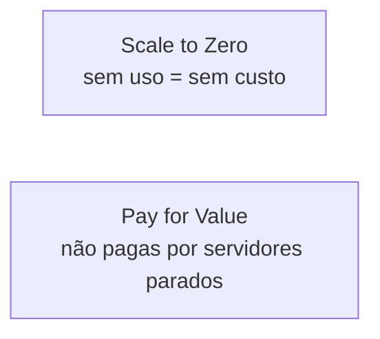
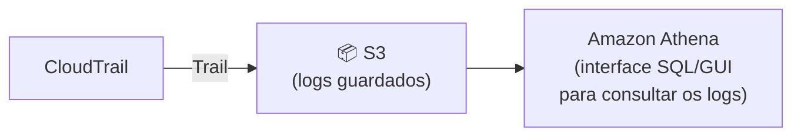
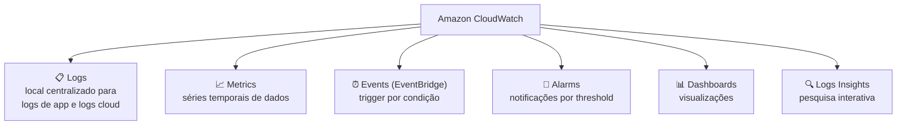
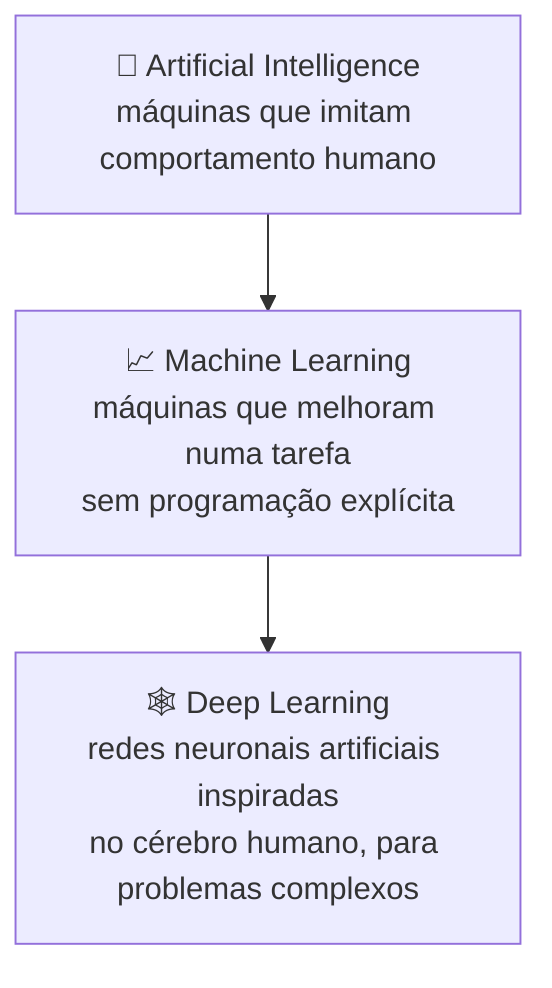
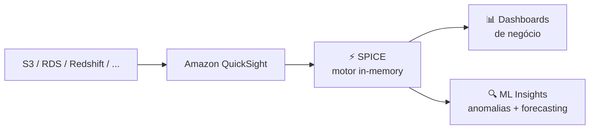

# Aula 11 — PaaS, Serverless, Windows, Logging, ML/AI e Big Data

# 🏗️ PARTE 1 — AWS Elastic Beanstalk

**Platform as a Service (PaaS):** permite aos clientes desenvolver, correr e gerir aplicações sem terem de construir e manter toda a complexidade de infraestrutura normalmente associada ao desenvolvimento e lançamento de apps.

> **Elastic Beanstalk:** PaaS para fazer deploy de aplicações web com pouco ou nenhum conhecimento da infraestrutura subjacente — foca-te em escrever código, em vez de pipelines de deployment e tarefas de DevOps.

- ⚠️ **Não é recomendado para apps de produção** de grandes empresas (falta de controlo fino sobre a infraestrutura).
- É alimentado por **templates CloudFormation**, que configuram automaticamente por ti:
  - Elastic Load Balancer
  - Auto Scaling Groups
  - Base de dados RDS
  - Instâncias EC2 pré-configuradas
  - Ambiente Docker, se preferires correr containerizado

> Deploy de apps **muito simples e rápido**.

---

# ⚡ PARTE 2 — Serverless

O servidor subjacente, a infraestrutura e o SO são geridos pelo **cloud provider**. Por norma, serverless é **altamente disponível, escalável e económico** — pagas pelo que usas.

| Princípio | Significado |
|---|---|
| **Scale to Zero** | Se os recursos não estão a ser usados, o serverless **não custa nada** |
| **Pay for Value** | Não pagas por servidores "idle" (parados à espera) |

## Serviços serverless

| Serviço | Descrição |
|---|---|
| **DynamoDB** | Base de dados NoSQL key/value e de documentos, serverless. Desenhada para escalar a milhares de milhões de registos — não geres shards |
| **S3** | Serviço de object storage serverless. Uploads de ficheiros muito grandes e em quantidade ilimitada. Pagas pelo que armazenas |
| **ECS Fargate** | Orquestração de containers serverless — igual ao ECS, mas pagas **on-demand** por container em execução (com ECS "puro" tens sempre um servidor EC2 ligado, mesmo sem containers a correr) |
| **AWS Lambda** | Serviço de funções serverless — corres código sem provisionar nem gerir servidores. Carregas um pequeno pedaço de código, escolhes a memória e o tempo máximo de execução. Cobrado com base no tempo de execução |
| **Step Functions** | Serviço de máquina de estados — coordena múltiplos serviços AWS em workflows serverless. Facilita partilhar dados entre Lambdas, ter um grupo de Lambdas à espera umas das outras, passos lógicos. Também funciona com tasks do Fargate |
| **Aurora Serverless** | Versão on-demand e serverless do Aurora. Tem a maioria dos benefícios do Aurora, mas pode ter *cold starts*, ou é ideal quando não tens muito tráfego constante |

---

# 🪟 PARTE 3 — Windows na AWS

| Serviço | Descrição |
|---|---|
| **Windows Server on EC2** | Instâncias EC2 a correr Windows Server |
| **SQL Server on RDS** | SQL Server como base de dados gerida |
| **AWS Directory Service** | Corre o Microsoft Active Directory (AD) como serviço gerido |
| **AWS License Manager** | Facilita gerir licenças de software de fornecedores como a Microsoft |
| **Amazon FSx for Windows File Server** | Storage gerido e escalável para Windows |
| **AWS SDK** | Escreves código na tua linguagem preferida para interagir com a API da AWS. Suporta **.NET** — favorito dos developers Windows |
| **Amazon WorkSpaces** | Corre um ambiente de trabalho virtual — podes lançar um desktop Windows 10 para fornecer postos de trabalho seguros e duráveis |
| **AWS Lambda** | Suporta **PowerShell** |
| **AWS Migration Acceleration Program** | Metodologia de migração para mover grandes empresas Windows para a AWS |

## AWS License Manager em detalhe

> **BYOL (Bring Your Own License):** reutilizar uma licença de software já existente para correr software de um fornecedor num serviço de computação cloud. Poupa dinheiro, já que a licença pode ter sido comprada em massa ou com desconto, mais barato do que comprar de novo.

**AWS License Manager:** serviço que gere as tuas licenças de software.

- Gere software licenciado com base em: **vCPUs, cores físicos, sockets, ou número de máquinas**.
- Produtos de fornecedores como: **Microsoft, IBM, SAP, Oracle**.

> ⚠️ Para licenças de Windows Server e SQL Server, normalmente precisas de usar um **Dedicated Host** (liga ao conceito já visto na Aula 7).

---

# 📊 PARTE 4 — Serviços de Logging

## AWS CloudTrail

Regista chamadas à **API** entre serviços AWS. Permite governança, compliance, auditoria operacional e de risco da tua conta.

**Perguntas que o CloudTrail responde:**
- Quem criou este bucket?
- Quem lançou aquela instância EC2 cara?
- Detetar agentes maliciosos
- Automatizar respostas
- Detetar má configuração por parte de developers

### Os 4 "W" de cada evento

| | Informação |
|---|---|
| **Where** | IP de origem |
| **When** | Hora do evento |
| **Who** | Utilizador, user agent |
| **What** | Região, recurso, ação |

> Os logs ficam disponíveis durante os **últimos 90 dias**, via *Event History*. Se precisares de mais do que 90 dias, tens de criar um **Trail**.

---

## Amazon CloudWatch

Coleciona dados de **múltiplos serviços**.

| Componente | Descrição |
|---|---|
| **CloudWatch Logs** | Local centralizado para guardar dados de log da cloud e das tuas apps |
| **CloudWatch Metrics** | Conjunto ordenado por tempo de pontos de dados — uma variável monitorizada ao longo do tempo. Métricas predefinidas para EC2: uso de CPU, operações de leitura/escrita em disco, tráfego de rede de entrada/saída, etc. |
| **CloudWatch Events (EventBridge)** | Aciona ações com base numa condição (ex.: a cada hora, tirar um snapshot do servidor) |
| **CloudWatch Alarms** | Notificações baseadas em métricas. Defines um **threshold**; quando violado, o alarme muda de estado (**OK**, **Alarm**, ou **Insufficient Data** — acabou de começar, não disponível, ou dados insuficientes). Ao mudar de estado, podes acionar: notificações, Auto Scaling Group, ação na EC2 |
| **CloudWatch Dashboard** | Cria dashboards de visualização com base em métricas |
| **CloudWatch Logs Insights** | Pesquisa e analisa interativamente os teus dados de log: filtragem robusta, menos trabalhoso do que exportar para S3 e analisar com Athena, suporta todos os tipos de log, usa sintaxe de query própria. ⚠️ As queries expiram ao fim de **15 minutos**, e os resultados ficam disponíveis durante **7 dias** |

---

## AWS X-Ray

Sistema de **tracing distribuído**: vês como os dados se movem de uma app para outra, quanto tempo demorou, e se falhou em algum ponto do percurso.

---

# 🤖 PARTE 5 — Machine Learning e IA

## A hierarquia AI → ML → Deep Learning

| Termo | Definição |
|---|---|
| **Artificial Intelligence (AI)** | Máquinas que executam tarefas que imitam comportamento humano |
| **Machine Learning (ML)** | Máquinas que melhoram numa tarefa **sem programação explícita** |
| **Deep Learning** | Usa redes neuronais artificiais, inspiradas no cérebro humano, para resolver problemas complexos |

## Amazon SageMaker

Serviço totalmente gerido para **construir, treinar e fazer deploy** de modelos de machine learning.

| Framework suportado | Descrição |
|---|---|
| **Apache MXNet on AWS** | Framework de deep learning |
| **TensorFlow** | Biblioteca de inteligência de máquina |
| **PyTorch** | Framework de machine learning |

| Serviço relacionado | Função |
|---|---|
| **SageMaker Ground Truth** | Serviço de etiquetagem (labeling) de dados, usado para treinar modelos |
| **Amazon Augmented AI** | Serviço de revisão com intervenção humana |

## Serviços de IA especializados

| Serviço | Função |
|---|---|
| **Amazon CodeGuru** | Análise de código com ML — revê e sugere melhorias à qualidade do código |
| **Amazon Lex** | Interface de conversação (chatbots por voz e texto) |
| **Amazon Personalize** | Recomendações em tempo real |
| **Amazon Polly** | Texto para voz (text-to-speech) |
| **Amazon Rekognition** | Reconhecimento de imagem e vídeo — deteta e etiqueta objetos, pessoas, celebridades, etc. |
| **Amazon Transcribe** | Voz para texto (speech-to-text) |
| **Amazon Textract** | OCR — extrai texto de documentos digitalizados |
| **Amazon Translate** | Tradução automática via redes neuronais |
| **Amazon Comprehend** | Processamento de linguagem natural (NLP) — encontra relações no texto para gerar insights |
| **Amazon Forecast** | Previsão de séries temporais |
| **AWS Deep Learning AMI** | EC2 pré-instalada com frameworks populares de deep learning (TensorFlow, PyTorch, ...) |
| **AWS Deep Learning Containers** | Imagens Docker pré-instaladas com os mesmos frameworks |
| **AWS DeepComposer** | Teclado musical com machine learning |
| **AWS DeepLens** | Câmara de vídeo com deep learning |
| **AWS DeepRacer** | Carrinho de corrida autónomo com machine learning |
| **Amazon Elastic Inference** | Anexa aceleração GPU de baixo custo a instâncias EC2, reduzindo até **75%** o custo de correr inferência de deep learning |
| **Amazon Fraud Detector** | Serviço de deteção de fraude totalmente gerido |
| **Amazon Kendra** | Motor de pesquisa empresarial com ML — usa linguagem natural para sugerir respostas a perguntas, em vez de simples correspondência de palavras-chave |

## IA — serviços mais recentes

| Serviço | Função |
|---|---|
| **Amazon Bedrock** | Serviço cloud de LLM (Large Language Model) — gera respostas em texto e imagem. Pensa nisto como um "ChatGPT" da AWS |
| **Amazon CodeWhisperer** | Assistente de código com IA — equivalente ao GitHub Copilot |
| **Amazon DevOps Guru** | Usa ML para analisar dados operacionais, métricas e eventos da app, detetando anomalias operacionais |
| **Amazon Lookout** (Equipment/Metrics/Vision) | Usa modelos de ML para controlo de qualidade e inspeções automatizadas |
| **Amazon Monitron** | Prevê downtime não planeado de equipamento |
| **AWS Neuron** | Corre workloads de deep learning em instâncias baseadas em AWS Inferentia e AWS Trainium |

## Generative AI

Tipo de IA capaz de **gerar conteúdo novo**: texto, imagens, música ou outras formas de media.

---

# 📈 PARTE 6 — Big Data e Analytics

> **Big Data:** volumes massivos de dados estruturados/não estruturados, tão grandes que são difíceis de mover e processar.

## Serviços de Big Data

| Serviço | Função |
|---|---|
| **Amazon Athena** | Serviço de query interativo serverless. Pega em ficheiros CSV/JSON num bucket S3 e carrega-os numa tabela SQL temporária, para correres queries. Usa quando queres fazer query a ficheiros CSV ou JSON |
| **Amazon CloudSearch** | Serviço de pesquisa full-text — para adicionares pesquisa ao teu website |
| **Amazon Elasticsearch Service** | Cluster Elasticsearch gerido |
| **Kinesis Data Streams** | Serviço de streaming de dados em tempo real — crias produtores que enviam dados para a stream; múltiplos consumidores podem consumir os dados |
| **Kinesis Firehose** | Versão serverless e mais simples do Data Streams — pagas on-demand pela quantidade de dados consumida |
| **Amazon Kinesis Data Analytics** | Corre queries em tempo real contra dados na stream, podes criar relatórios |
| **Amazon Kinesis Video Streams** | Permite analisar e processar vídeo em streaming, em tempo real |
| **Managed Kafka Service (MSK)** | Apache Kafka totalmente gerido |
| **Amazon Redshift** | Data warehouse à escala de petabytes — para gerar analytics/relatórios rapidamente a partir de grandes volumes de dados |
| **Amazon QuickSight** | Dashboard de Business Intelligence — cria dashboards de negócio para apoiar decisões (semelhante ao Power BI) |
| **AWS Data Pipeline** | Automatiza o movimento de dados |
| **AWS Glue** | Serviço de ETL (Extract, Transform, Load) |
| **AWS Lake Formation** | Repositório centralizado, organizado e protegido, que guarda todos os teus dados |

### Amazon QuickSight em detalhe

Dashboard de Business Intelligence que permite ingerir dados de storage ou bases de dados AWS, para visualizar rapidamente dados de negócio, com pouco conhecimento de programação ou fórmulas.

- Usa o **SPICE** (motor de cálculo in-memory) para performance ultra-rápida, a escala.
- **QuickSight ML Insights:** deteta anomalias e faz previsões (forecasting) precisas.

---

📺 *Progresso: 10h54min de vídeo assistido.*