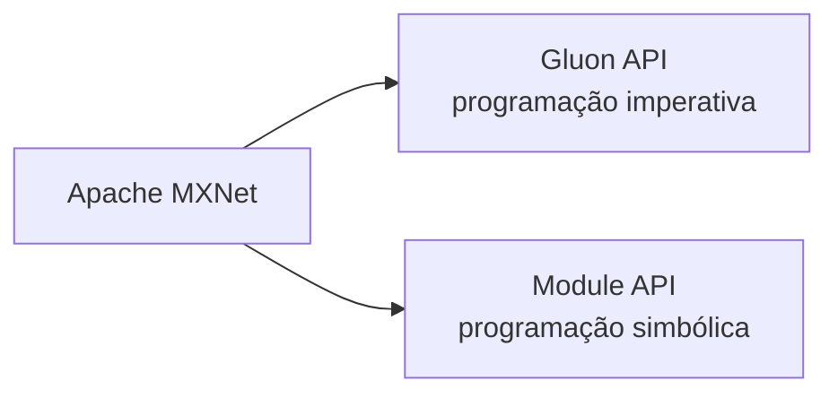
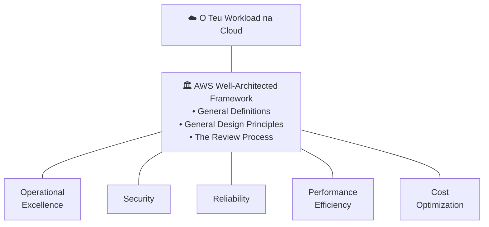
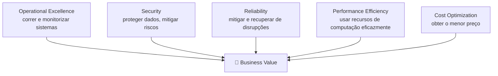
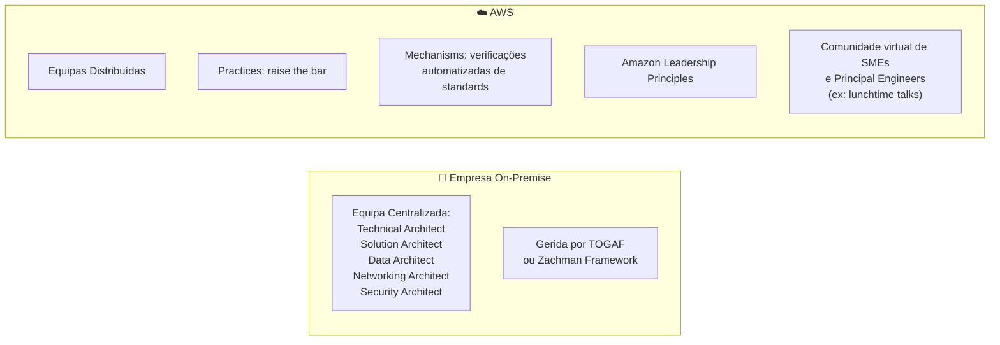
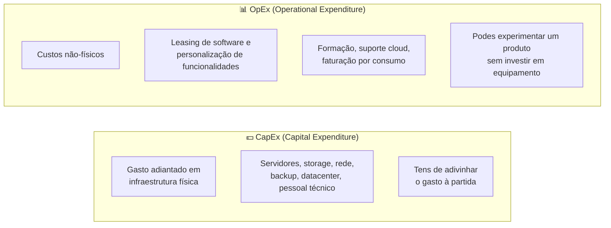
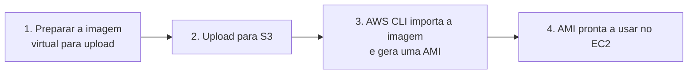

# Aula 12 — Frameworks de ML, Hardware, Well-Architected Framework e Migração

# 🧠 PARTE 1 — Frameworks e Ferramentas de ML/DL

| Framework | Descrição |
|---|---|
| **Apache MXNet** | Adotado pela AWS, suporta programação **imperativa** e **simbólica** |
| **PyTorch** | Biblioteca de tensores otimizada para deep learning, usando GPU e CPU |
| **TensorFlow** | Framework de machine learning de **baixo nível** |
| **Keras** | Framework de **alto nível**, construído por cima do TensorFlow e distribuído com ele |
| **Apache Spark** | Motor de analytics unificado para processamento de dados a larga escala |
| **SparkML** | Conjunto uniforme de APIs de alto nível, para ajudar a criar e afinar pipelines práticos de machine learning |

---

## Apache MXNet em detalhe

Framework de deep learning/machine learning adotado pela AWS, que suporta programação **imperativa** e **simbólica**, em múltiplas linguagens: Python, Java, Julia, MATLAB, JavaScript, etc.

| Característica | Descrição |
|---|---|
| **Escalável** | Desenhado para infraestrutura cloud distribuída |
| **Flexível** | Suporta programação imperativa e simbólica |
| **Portátil** | Pode ser usado em dispositivos de baixa capacidade, edge devices, e em compute serverless |
| **Multi-linguagem** | Suporta várias linguagens de programação |

### Duas interfaces

---

# ⚙️ PARTE 2 — Hardware para Machine Learning

## Intel vs. ARM

| | **Intel** | **ARM** |
|---|---|---|
| Tipo | Fabricante de semicondutores, instruction set **x86** | Instruction set com **menos instruções** |
| Eficiência energética | — | Normalmente **melhor eficiência energética**, logo **custos mais baixos** |

## Processadores especializados

| Processador | Função |
|---|---|
| **Intel Xeon Scalable** | CPU de alta performance, desenhado para empresas — comummente usado em instâncias AWS |
| **Habana Gaudi** | Processador de treino de IA, feito à medida para treinar modelos de deep learning |

## GPU (Graphics Processing Unit)

Processador especializado para renderizar rapidamente imagens e vídeo de alta resolução **em simultâneo**. Pode ter **milhares de núcleos**, otimizados para muitas tarefas em paralelo.

**Boa para:**
- Renderização de gráficos
- Mineração de criptomoeda
- Deep learning e Machine Learning

## CUDA e NVIDIA

- **NVIDIA:** fabricante de GPUs.
- **CUDA:** plataforma de computação paralela e API da NVIDIA, que permite aos developers usar GPUs com suporte CUDA.

### Instâncias EC2 com GPU

| Instância | GPU |
|---|---|
| **EC2 P3** | Tesla V100 |
| **EC2 G3** | Tesla M60 |
| **EC2 G4** | T4 |
| **EC2 P4** | Tesla A100 |

> Integra-se com o NVIDIA Deep Learning SDK.

---

# 🔎 PARTE 3 — Amazon Athena (em detalhe)

Serviço de query interativo que facilita analisar dados **diretamente a partir do S3** — baseado em **Apache Presto**.

### Pode fazer duas coisas

| Modo | Descrição |
|---|---|
| **Athena SQL** | Corre queries SQL em buckets S3 |
| **Apache Spark on Amazon Athena** | Corre analytics de dados interativamente |

> **Serverless** — pagas pelo que usas.

**Integra-se com:** CloudFormation, CloudFront, CloudTrail, DataZone, ELB, EMR, AWS Glue Data Catalog, IAM, QuickSight, S3 Inventory, Step Functions, Systems Manager Inventory, VPC.

---

## AWS Glue

Serviço de integração de dados **serverless**.

> Cria, corre e monitoriza visualmente pipelines de **ETL (Extract, Transform, Load)**, para carregar dados nos teus data lakes.

---

# 🏛️ PARTE 4 — AWS Well-Architected Framework

O **AWS Well-Architected Framework** é um **whitepaper criado pela AWS** para ajudar os clientes a construir usando as **boas práticas definidas pela AWS**. Está disponível em `aws.amazon.com/architecture/well-architected`.

O framework está dividido em **5 secções, chamadas pilares**, cada uma a abordar um aspeto diferente (uma "lente") que pode ser aplicada a um workload na cloud.

## Estrutura geral

| Camada | O que representa |
|---|---|
| **Your Cloud Workload** | A aplicação/sistema que estás a construir na cloud |
| **Well-Architected Framework** | A "fundação" sobre a qual assenta o workload — inclui três componentes: **General Definitions**, **General Design Principles** e **The Review Process** |
| **5 Pilares** | As colunas que sustentam o framework, cada uma focada num aspeto diferente |

> 🏗️ **A analogia do print:** *"If the foundation is not solid, structural problems will arise."* — tal como num edifício, se a fundação (a arquitetura) não for sólida, vão surgir problemas estruturais no teu workload mais tarde.

## Os 5 pilares

| Pilar | Foco |
|---|---|
| **Operational Excellence** | Correr e monitorizar sistemas |
| **Security** | Proteger dados, mitigar risco |
| **Reliability** | Mitigar e recuperar de disrupções |
| **Performance Efficiency** | Usar os recursos de computação de forma eficaz |
| **Cost Optimization** | Obter o menor preço possível |

## Definições gerais

| Termo | Definição |
|---|---|
| **Component** | Código, configurações, um recurso AWS |
| **Workload** | Conjunto de componentes que trabalham em conjunto |
| **Milestones** | Mudanças-chave na tua arquitetura ao longo do ciclo de vida do produto |
| **Architecture** | Como os componentes trabalham em conjunto num workload |
| **Technology Portfolio** | Coleção de workloads necessários para o negócio funcionar |

## Anatomia de um pilar

Cada pilar do Well-Architected Framework é estruturado como:

| Secção | Descrição |
|---|---|
| **Design Principles** | Lista de princípios de design a considerar na implementação *(a parte mais importante para o exame)* |
| **Definition** | Visão geral da boa prática |
| **Best Practices** | Informação sobre cada boa prática |
| **Resources** | Documentação de apoio |

---

## Pilar: Operational Excellence

| Princípio | Descrição |
|---|---|
| **Perform operations as code** | Limita o erro humano e permite respostas consistentes → **IaC** |
| **Make frequent, small, reversible changes** | Rollbacks, mudanças incrementais, blue/green, CI/CD |
| **Refine operations procedures frequently** | Usa *game days* para simular tráfego ou falhas nos teus workloads de produção |
| **Anticipate failure** | Prepara-te antecipadamente para falhas |
| **Learn from operational failures** | Aprende com falhas operacionais passadas |

## Pilar: Security

| Princípio | Descrição |
|---|---|
| **Implement strong identity foundation** | Menor privilégio, identidade centralizada, evitar credenciais de longa duração |
| **Enable traceability** | Monitoriza alertas e audita ações/mudanças no ambiente; recolha de logs e métricas; automatiza investigação e remediação |
| **Apply security at all layers** | Segurança em todas as camadas |
| **Automate security best practices** | Automatiza as boas práticas de segurança |
| **Protect data in transit and at rest** | Protege os dados tanto em trânsito como em repouso |
| **Keep people away from data** | Minimiza o acesso humano direto aos dados |
| **Prepare for security events** | Ferramentas para detetar, investigar e recuperar de incidentes |

## Pilar: Reliability

- Recuperar **automaticamente** de falhas
- Testar procedimentos de recuperação
- Escalar **horizontalmente** para aumentar a disponibilidade agregada do sistema
- Parar de adivinhar a capacidade
- Gerir mudanças por automação (**IaC**)

## Pilar: Performance Efficiency

- Democratizar tecnologias avançadas
- Ir global em minutos
- Usar arquiteturas **serverless**
- Experimentar mais frequentemente
- Considerar a "simpatia mecânica" (*mechanical sympathy* — desenhar software que aproveita bem as características do hardware subjacente)

## Pilar: Cost Optimization

- Implementar gestão financeira cloud
- Adotar o modelo de **consumo**
- Medir a eficiência geral
- Parar de gastar dinheiro em trabalho pesado não diferenciado (*undifferentiated heavy lifting*)
- Analisar e atribuir despesa

---

## AWS Well-Architected Tool

Ferramenta de auditoria para verificar o quão alinhado está o teu workload com o Well-Architected Framework — essencialmente uma **checklist**, com referências próximas, que ajuda a montar um relatório para partilhar com executivos e stakeholders-chave.

## AWS Architecture Center

Portal web com boas práticas e arquiteturas de referência.

---

# 🏢 PARTE 5 — Organização e Princípios

## Arquitetura: On-Premise vs. AWS

| | On-Premise | AWS |
|---|---|---|
| Estrutura da equipa | **Centralizada** (Technical/Solution/Data/Networking/Security Architect) | **Distribuída** |
| Suporte | TOGAF ou Zachman Framework | Practices, Mechanisms (verificações automatizadas), Amazon Leadership Principles |
| Partilha de conhecimento | — | Comunidade virtual de SMEs e Principal Engineers (ex.: *lunchtime talks*, reaproveitados como material de onboarding) |

## Amazon Leadership Principles

Conjunto de princípios usados na tomada de decisão, resolução de problemas, brainstorming e contratação:

- Customer Obsession
- Ownership
- Invent and Simplify
- Are Right, A Lot
- Learn and Be Curious
- Hire and Develop the Best
- Insist on the Highest Standards
- Think Big
- Bias for Action
- Frugality
- Earn Trust
- Dive Deep
- Have Backbone; Disagree and Commit
- Deliver Results
- Strive to be Earth's Best Employer
- Success and Scale Bring Broad Responsibility

## Princípios gerais de design

- Parar de adivinhar as necessidades de capacidade
- Testar sistemas à escala de produção
- Automatizar para facilitar a experimentação arquitetural
- Permitir arquiteturas evolutivas
- Orientar a arquitetura com base em dados
- Melhorar através de *game days*

---

# 💰 PARTE 6 — Custos e Migração

## Total Cost of Ownership (TCO)

Estimativa financeira destinada a ajudar compradores e proprietários a determinar os custos **diretos e indiretos** de um produto ou serviço. Muito útil ao migrar de on-premise para a cloud.

### Exemplo: licenças de software

| On-Premise (CapEx) | AWS (OpEx) |
|---|---|
| Taxas de licença de software | Taxas de subscrição |
| Implementação | Implementação |
| Configuração | Configuração |
| Formação | Formação |
| Segurança física | — |
| Hardware | — |
| Pessoal de TI | — |
| Manutenção | — |

## CapEx vs. OpEx

| | **CapEx** | **OpEx** |
|---|---|---|
| Natureza | Gasto adiantado em infraestrutura **física** | Custos **não-físicos** |
| Exemplos | Servidores, storage, rede, backup/arquivo, datacenter, pessoal técnico | Leasing de software, formação, suporte cloud, faturação por uso de compute/storage |
| Planeamento | Tens de **adivinhar** o gasto antecipadamente | Podes **experimentar** um produto/serviço sem investir em equipamento |

## Mudança de pessoal de TI

Ao migrar para a cloud:

- A empresa continua a precisar de uma equipa de TI durante a **fase de migração**.
- As funções transitam para novos papéis cloud — ex.: de "networking" para "cloud networking".
- O foco passa de **gerir infraestrutura** para **gerar receita**.

---

## AWS Pricing Calculator

Ferramenta gratuita de estimativa de custos, usada no browser, **sem precisar de conta AWS**.

## AWS Migration Evaluator

Ferramenta de estimativa usada para determinar o custo da tua infraestrutura on-premise **existente**, para comparar com o custo AWS de uma migração cloud planeada.

> Usa um **agentless collector**, que recolhe dados da tua infraestrutura on-premise sem precisar de instalar agentes.

---

## EC2 VM Import/Export

Importa imagens de máquinas virtuais para a EC2. Suporta: **VMware, Citrix, Hyper-V**, etc.

---

## AWS Database Migration Service (DMS)

**Suporta:** Oracle DB, Microsoft SQL, MongoDB, MySQL, PostgreSQL.

---

📺 *Progresso: 11h47min de vídeo assistido.*