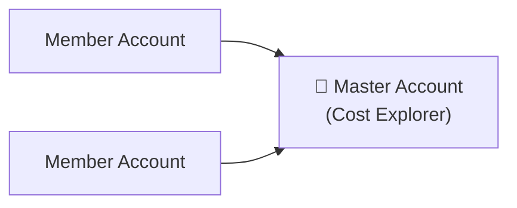
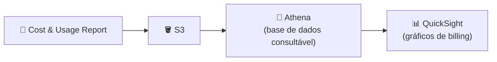

# Aula 13 — Serviços Gratuitos, Planos de Suporte, Billing, Trusted Advisor, SLA e Custos

# 🆓 PARTE 1 — Serviços Gratuitos

| Serviço | Descrição |
|---|---|
| **IAM** | Gestão de identidades e acessos |
| **VPC** | Rede virtual privada |
| **Auto Scaling** | Escalar recursos automaticamente |
| **CloudFormation** | Infraestrutura como código |
| **Elastic Beanstalk** | Deploy de aplicações geridas |
| **OpsWorks** | Gestão de configuração (Chef/Puppet) |
| **Amplify** | Desenvolvimento de apps web/mobile |
| **AppSync** | APIs GraphQL geridas |
| **CodeStar** | Gestão de projetos de desenvolvimento |
| **Organizations + Consolidated Billing** | Gestão de múltiplas contas e faturação única |
| **AWS Cost Explorer** | Análise de custos e utilização |

> ⚠️ Estes serviços são gratuitos **por si**, mas **provisionam outros serviços que podem ter custo** (aplica-se de *Auto Scaling* até *CodeStar*).

---

# 🛟 PARTE 2 — Support Plans *(importante)*

| | **Basic** | **Developer** | **Business** | **Enterprise** |
|---|---|---|---|---|
| **Preço** | 0 USD/mês | 29 USD/mês | 100 USD/mês | 15 000 USD/mês |
| **Suporte** | Email só para billing e conta | Email técnico (24h até resposta) | Email + chat/telefone 24/7 | Email + chat/telefone 24/7 |
| **Suporte de terceiros** | — | ❌ Não | ✅ | ✅ |
| **General guidance** | — | < 24h | < 24h | < 24h |
| **System impaired** | — | < 12h | < 12h | < 12h |
| **Production system impaired** | — | — | < 4h | < 4h |
| **Production system down** | — | — | < 1h | < 1h |
| **Business-critical system down** | — | — | — | < 15 min |
| **Trusted Advisor** | 7 checks | 7 checks | **Todos** os checks | **Todos** os checks |
| **Extras Enterprise** | — | — | — | Personal concierge + **TAM** |

> 📝 *Nota pessoal: "print costs" — falta colar o print da tabela de custos.*

## TAM (Technical Account Manager)

Orientação **proativa** e suporte **reativo** para ajudar a ter sucesso na AWS — **apenas disponível no plano Enterprise**.

- Constrói soluções e dá orientação técnica
- Garante que os serviços AWS se mantêm operacionais, reduzindo custo e complexidade
- Compreende as necessidades do negócio e desenvolve uma relação de confiança
- Colabora com a equipa de negócio profissional
- Faz revisões de disrupções de serviço, métricas, etc.

## Support Center

- Só a **root account** pode criar um *case*
- Também é onde se pode **mudar o plano de suporte**

---

# 🛒 PARTE 3 — AWS Marketplace e Consolidated Billing

## AWS Marketplace

- Milhares de listagens de software de outros fornecedores
- Produtos podem ser **gratuitos** ou ter **custo associado**
- Também podes **vender as tuas soluções** a outros clientes AWS

## Consolidated Billing

Permite **pagar várias contas AWS com uma única fatura**.

### Descontos por volume

> Quanto mais usas, mais poupas.

Exemplo — **Data Transfer**:

| Escalão | Preço |
|---|---|
| Primeiros 10 TB | 0,17 USD/GB |
| Próximos 40 TB | 0,13 USD/GB |

> Com consolidated billing, o uso de todas as contas soma-se, por isso atinges escalões mais baratos mais depressa.

---

# 🔍 PARTE 4 — AWS Trusted Advisor

Ferramenta de recomendações que **monitoriza automaticamente** a tua conta AWS e dá recomendações acionáveis. É uma checklist automatizada de boas práticas.

**5 categorias:** Cost Optimization · Performance · Security · Fault Tolerance · Service Limits

## Basic | Developer — 7 checks

Os **6 primeiros são de segurança**:

| # | Check |
|---|---|
| 1 | **MFA no Root** |
| 2 | **Security Groups** — portas específicas sem restrição |
| 3 | **Permissões S3** |
| 4 | **EBS public snapshot** |
| 5 | **RDS public snapshot** |
| 6 | **IAM use** — desencorajar o uso do acesso root |
| 7 | **Service Limits** *(todos os checks de service limits são gratuitos)* |

## Business | Enterprise — todos os checks

| Categoria | Exemplos |
|---|---|
| **Cost Optimization** | Load balancers inativos, Elastic IPs não associados |
| **Performance** | Instâncias EC2 com alta utilização |
| **Security** | MFA no root, rotação de access keys IAM |
| **Fault Tolerance** | Backups RDS |
| **Service Limits** | VPC |

---

# 📜 PARTE 5 — Service Level Agreements (SLA)

**SLA** = compromisso formal sobre o nível esperado de serviço.

| Termo | Significado | Exemplo |
|---|---|---|
| **SLI** (Service Level Indicator) | Métrica/medição que indica o desempenho que o cliente está a receber num dado momento | Uptime, performance, disponibilidade, latência, taxa de erro |
| **SLO** (Service Level Objective) | Objetivo que o fornecedor acordou cumprir, com um alvo percentual específico | Disponibilidade de 99,99% num período de 3 meses |

## Exemplos de SLA

| Serviço | SLA |
|---|---|
| **DynamoDB** | 99,99% disponível, com uptime mensal por região AWS |
| **Compute (EC2, EBS, ECS, Fargate)** | **Nível região** (deploy em vários AZs/regiões) e **nível instância** (governa cada instância EC2 individualmente) |
| **RDS** | Instâncias **Multi-AZ** com uptime mensal de pelo menos **99,95%** |

> 💳 Se algum SLA não for cumprido, tens direito a receber **service credits**.

## Dashboards de saúde

| Dashboard | Função |
|---|---|
| **Service Health Dashboard** | Mostra o estado **geral** dos serviços AWS (ícone + detalhes do estado) |
| **Personal Health Dashboard** | Alertas e orientação sobre eventos AWS que podem **afetar o teu ambiente** |

---

# 🚨 PARTE 6 — AWS Abuse

A equipa **AWS Trust and Safety** lida com abusos originados na plataforma AWS:

| Tipo de abuso | Descrição |
|---|---|
| **Spam** | Emails não solicitados vindos da AWS |
| **Port scanning** | Logs mostram IPs da AWS a enviar pacotes para várias portas do teu servidor |
| **Denial of Service (DoS)** | Ataques de negação de serviço |
| **Intrusion attempts** | IPs AWS usados para tentar entrar nos teus recursos |
| **Hosting prohibited content** | Alojamento de conteúdo proibido |
| **Distributing malware** | Recursos AWS usados para distribuir software criado para causar dano |

> ❗ **Não uses o AWS Support** para isto → envia email para **abuse@amazonaws.com** ou preenche o **AWS Abuse Report Form**.

---

# 🎁 PARTE 7 — Free Tier, Credits e APN

## AWS Free Tier

Permite usar a AWS sem custo:

- **Primeiros 12 meses** (limites mensais)
- Alguns serviços têm uso gratuito **para sempre** até um certo limite mensal

| Serviço | Free Tier |
|---|---|
| **EC2** | t2.micro, 750 h/mês durante 1 ano |
| **RDS** | db.t2.micro, 750 h/mês durante 1 ano |
| **ELB** | 750 h/mês durante 1 ano |
| **CloudFront** | 50 GB de data transfer |
| **Amazon Connect** | 90 min de tempo de chamada |

## AWS Credits

- Equivalem a **USD** na plataforma AWS
- Podem ser obtidos por: **AWS Activate Startup Program**, **participação em surveys**, etc.
- Têm **data de expiração**
- Podem ser usados na maioria dos serviços AWS

## AWS Partner Network (APN)

Programa global de parceiros da AWS: **formação** e **marketing**.

| Tipo de parceiro | Função |
|---|---|
| **Consulting Partner** | Ajuda empresas a usar a AWS |
| **Technology Partner** | Constrói tecnologia por cima da AWS, como serviço |

- Níveis (*tiers*): **Select → Advanced → Premier**, com custos diferentes
- É preciso ter **certificações AWS** para ser parceiro
- Parceiros podem obter **AWS credits**

---

# 💰 PARTE 8 — Ferramentas de Gestão de Custos

## AWS Budgets

Alertas quando **excedes** ou estás a **aproximar-te** do orçamento definido.

- Tipos: **cost**, **usage** e **reservation** budgets
- Acompanhamento **mensal, trimestral ou anual**
- Alertas suportam: **EC2, RDS, Redshift, ElastiCache**
- **Primeiros 2 budgets gratuitos**, depois 0,02 USD/dia
- **Budget Reports:** relatórios por email (diário, semanal ou mensal) com a performance do budget

## AWS Cost and Usage Reports (CUR)

Folha de cálculo detalhada para analisar os custos AWS.

## Cost Allocation Tags

Metadados **opcionais** anexados a recursos AWS, que permitem gerar um **Cost and Usage Report** por tag.

## Billing Alarms

Alarmes **CloudWatch** para monitorizar o gasto.

1. Ativar **billing alerts**
2. Ir a **CloudWatch → Alarms**
3. Escolher **Billing** como métrica
4. Especificar métrica e condições

## AWS Cost Explorer

Visualizar, compreender e gerir custos e utilização AWS ao longo do tempo.

- Especificar **tipo, intervalo e agregação**
- Os **relatórios por defeito** ajudam a obter insights rapidamente

---

📺 *Progresso: 12h39min de vídeo assistido.*