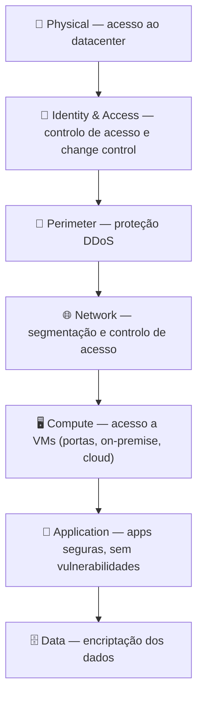
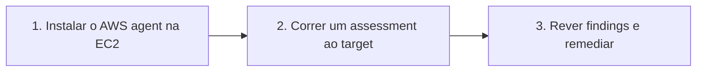
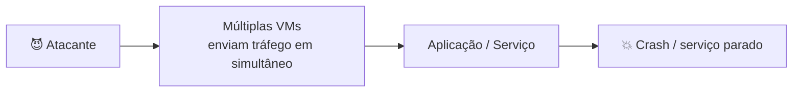
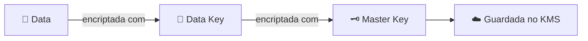

# Aula 14 — Pricing API, Segurança, Encriptação, Compliance e Serviços de Segurança AWS

# 💲 PARTE 1 — Pricing API e Savings Plans

## AWS Pricing API

| API | Formato |
|---|---|
| **Query API** | Via **JSON** |
| **Batch (Bulk) API** | Ficheiros em lote *(nas notas: "via html")* |

## Savings Plans — follow along

**Cost Explorer → Savings Plans →** escolher o plano (**Compute | EC2 | SageMaker**) **→** anos de compromisso **→** ...

## TAM (Technical Account Manager)

*(Repetido da Aula 13)* Orientação proativa e suporte reativo, **apenas no plano Enterprise**: constrói soluções, mantém serviços operacionais reduzindo custo e complexidade, e faz revisões de disrupções e métricas.

---

# 🛡️ PARTE 2 — Fundamentos de Segurança

## Defense in Depth (7 camadas)

| Camada | Foco |
|---|---|
| **Data** | Usar encriptação nos dados |
| **Application** | Aplicações seguras e livres de vulnerabilidades |
| **Compute** | Acesso às VMs (portas, on-premise, cloud) |
| **Network** | Limitar comunicação entre recursos com segmentação e controlo de acesso |
| **Perimeter** | Proteção **DDoS** para filtrar ataques de larga escala antes de causarem negação de serviço |
| **Identity and Access** | Controlar o acesso à infraestrutura e o change control |
| **Physical** | Limitar o acesso ao datacenter |

## CIA Triad

Modelo que descreve a base dos princípios de segurança e a relação de *trade-off* entre eles. Mencionado numa publicação do **NIST de 1977**.

| Pilar | Descrição |
|---|---|
| **Confidentiality** | Proteger os dados de quem não está autorizado. Na prática: chaves criptográficas para encriptar dados, e chaves para encriptar chaves (**envelope encryption**) |
| **Integrity** | Manter e garantir a exatidão e completude dos dados durante todo o ciclo de vida |
| **Availability** | A informação tem de estar disponível quando é necessária |

## Vulnerabilidades

Fraqueza na aplicação (falha de design ou bug de implementação) que permite a atacantes causar dano aos *stakeholders*.

**Exemplos:** buffer overflow, validação de dados imprópria, memory leak, violação do menor privilégio, uso de algoritmo criptográfico quebrado ou arriscado.

---

# 🔐 PARTE 3 — Encriptação, Hashing e Assinaturas Digitais

## Conceitos de encriptação

| Termo | Definição |
|---|---|
| **Cryptography** | Técnicas para comunicação segura na presença de terceiros (*adversaries*) |
| **Encryption** | Codificar informação com uma chave e uma cipher, guardando dados sensíveis num formato ininteligível. Recebe **plaintext** e produz **ciphertext** |
| **Cipher** | Algoritmo que faz a encriptação ou desencriptação |
| **Ciphertext** | Resultado da encriptação do plaintext |
| **Cryptographic key** | Variável usada com o algoritmo para encriptar/desencriptar |

## Simétrica vs. Assimétrica

| | **Simétrica** | **Assimétrica** |
|---|---|---|
| Chaves | A **mesma** chave para codificar e descodificar | **2 chaves**: uma para codificar, outra para descodificar |
| Exemplo | **AES** (Advanced Encryption Standard) | **RSA** (Rivest–Shamir–Adleman) |

## Hashing e Salting

Função que aceita um valor de tamanho arbitrário e o mapeia para uma estrutura de **tamanho fixo**.

- Processo **one-way** (não reversível)
- **Determinística:** o mesmo input dá sempre o mesmo output
- Usado para **guardar passwords** na base de dados: o utilizador introduz a password, faz-se o hash e compara-se com o hash guardado
- Algoritmos: **MD5**, **SHA-256**, **bcrypt**

> ⚠️ Se um atacante souber a função usada e roubar a base de dados, pode enumerar um dicionário de passwords para descobrir a original.

**Salting:** string aleatória, desconhecida do atacante, que entra na função de hash para mitigar a natureza determinística.

## Assinaturas Digitais (Digital Signature)

Esquema matemático para verificar a **autenticidade** de mensagens ou ficheiros. Dá **evidência de adulteração** (*tamper evidence*):

- Alguém modificou os dados?
- Os dados não vêm do remetente esperado?

| Algoritmo | Função |
|---|---|
| **Key generation** | Gera a chave pública e privada |
| **Signing** | Gera a assinatura com a chave **privada** + a mensagem |
| **Signature verification** | Verifica a autenticidade com a chave **pública** |

> 🔧 `ssh-keygen` é o comando conhecido para gerar um par de chaves pública/privada.

## Encriptação In Transit vs. At Rest

| | **In Transit** | **At Rest** |
|---|---|---|
| Quando | Dados a **mover-se** entre localizações | Dados **guardados** em storage |
| Tecnologias | **TLS/SSL** (TLS 1.2 e 1.3 são a boa prática) | **AES**, RSA |

---

# 📋 PARTE 4 — Compliance e Penetration Testing

## Compliance Programs

Políticas e procedimentos internos de uma empresa para cumprir leis, regras e regulamentos.

| Standard | Descrição |
|---|---|
| **ISO** (International Organization for Standardization) | **27001** — guia de implementação de controlos; **27017** — foco reforçado em segurança cloud |
| **SOC** (System and Organization Controls) | **SOC 1**, **SOC 2** (controlos internos, políticas e procedimentos relacionados com a segurança de um sistema), **SOC 3** |
| **PCI DSS** | Payment Card Industry Data Security Standard |

## Penetration Testing

Ciberataque simulado e **autorizado** a um sistema, para avaliar a sua segurança.

| ✅ Permitido (ex.) | ❌ Proibido |
|---|---|
| EC2, NAT Gateways, Load Balancers, RDS, CloudFront, API Gateways, ... | **DNS zone walking** via Route 53 hosted zones; **simulação de DDoS** |

> 📝 É preciso enviar um **formulário AWS** a avisar que vais fazer pentesting.

## AWS Artifact

Relatórios de **compliance** da AWS (PDFs).

---

# 🧰 PARTE 5 — Serviços de Segurança AWS

## Amazon Inspector

**Hardening:** eliminar o máximo de riscos de segurança possível.

Corre um **benchmark de segurança** contra EC2 específicas.

> Benchmark popular: **CIS** — **699 checks**.

## DDoS e AWS Shield

**DDoS:** tentativa maliciosa de interromper o tráfego normal inundando um site com grandes quantidades de tráfego falso.

**AWS Shield:** serviço gerido de proteção DDoS para workloads a correr na AWS.

## AWS GuardDuty

**IDS/IPS** (Intrusion Detection / Prevention System): dispositivo ou software que monitoriza redes ou sistemas à procura de atividade maliciosa ou violações de política.

**GuardDuty:** serviço de **threat detection** que monitoriza continuamente atividade suspeita e comportamento não autorizado, usando **machine learning** para analisar os logs AWS.

## AWS VPN

Estabelece um túnel seguro e privado entre a tua rede/dispositivo e a rede global AWS.

| Tipo | Liga |
|---|---|
| **Site-to-Site VPN** | Rede on-premise → VPC |
| **Client VPN** | Utilizadores → AWS ou redes on-premise |

> **IPSec:** conjunto de protocolos de rede que autentica e encripta os pacotes de dados para comunicação segura.

## AWS WAF

Protege a tua web app de exploits web comuns.

- Escreves as tuas **próprias regras** para permitir ou negar tráfego
- **Rulesets** de parceiros de segurança AWS no *AWS WAF Rules Marketplace*
- Usa-se com **CloudFront** ou **Application Load Balancer**
- Cobre o **OWASP Top 10**: injection, broken authentication, sensitive data exposure, XML external entities, broken access control, security misconfigurations, cross-site scripting, insecure deserialization, componentes com vulnerabilidades conhecidas, logging e monitoring insuficientes
- Pode fazer *bypass* de endereços IP

## Hardware Security Module (HSM)

Desenhado para **guardar chaves de encriptação**, mantendo-as em memória e **nunca as escrevendo em disco**.

| | **Multi-tenant** | **Single-tenant** |
|---|---|---|
| Serviço AWS | **AWS KMS** | **AWS CloudHSM** |
| Compliance | **FIPS 140-2 Level 2** | **FIPS 140-2 Level 3** |

### AWS KMS

Serviço gerido para criar e controlar as chaves de encriptação (**1 USD por chave**).

- **Multi-tenant**
- Usa **envelope encryption**

### AWS CloudHSM

HSM **single-tenant** como serviço, que automatiza provisionamento de hardware, patching de software, alta disponibilidade e backups.

- Permite gerar e usar as tuas chaves em **FIPS 140-2 Level 3**
- É o **mais caro**, porque recebes uma peça de hardware dedicada

## AWS Security Hub

**CSPM** (Cloud Security Posture Management): gera um **security score** para determinar a tua postura de segurança.

- Podes ativar **standards** (coleções de controlos de segurança → são **AWS Config rules**)

## AWS Audit Manager

Audita continuamente o uso da AWS para simplificar a avaliação de risco e compliance.

- **Framework library:** suporta vários standards (SOC 2, HIPAA, ...)
- Podes criar **assessments**, rever a evidência recolhida e gerar um relatório
- Recolhe evidência continuamente com **AWS Config** e **AWS Security Hub**

## AWS Firewall Manager

Configura e gere **regras de firewall de forma centralizada**:

- AWS WAF e WAF Classic
- Security Groups
- AWS Shield Advanced
- Amazon Route 53 Resolver DNS Firewall
- ...

---

# ⚖️ PARTE 6 — Comparações de Serviços

## AWS Config vs. AWS AppConfig

| | **AWS Config** | **AWS AppConfig** |
|---|---|---|
| Função | Ferramenta de **governance** — *compliance as code* | Automatiza o **deploy de configurações** de aplicações |
| Como | Cria regras que verificam se os recursos estão configurados como esperado; se não, notifica ou faz **auto-remediation** | Escreves um **validator** para garantir que a variável alterada não parte a web app; monitoriza deployments e faz **rollback** em caso de erro |

## SNS vs. SQS

| | **SNS** (Simple Notification Service) | **SQS** (Simple Queue Service) |
|---|---|---|
| Modelo | Passa mensagens (**pub/sub**) | Fila de mensagens, entrega garantida |
| Funcionamento | Envia notificações a **subscribers** de tópicos (geralmente emails de texto simples); pode **repetir** envios falhados | Coloca mensagens numa fila; as apps fazem *pull* com o AWS SDK |
| Extras | — | Retém mensagens até **14 dias**; ordem sequencial ou paralela; garante entrega **pelo menos uma vez** |

## SNS vs. SES vs. Pinpoint vs. WorkMail

*Todos enviam emails.*

| Serviço | Uso |
|---|---|
| **SNS** | Notificações pub/sub, geralmente emails de texto simples |
| **SES** (Simple Email Service) | Emails **transacionais**, disparados por ações na app (signup, reset de password, faturas) → emails HTML |
| **Pinpoint** | Emails **promocionais**: campanhas, segmentação de contactos, customer journeys |
| **WorkMail** | **Cliente de email web**, semelhante a Gmail/Outlook — emails da empresa |

## Amazon Inspector vs. AWS Trusted Advisor

*Ambas são ferramentas de segurança que fazem auditorias.*

| | **Amazon Inspector** | **Trusted Advisor** |
|---|---|---|
| Âmbito | Audita **uma única EC2** selecionada | Visão **holística** de recomendações em vários serviços e boas práticas |
| Output | Relatório de uma longa lista de checks (ex.: 699) | **Não gera PDF** |
| Exemplos | Resultados do benchmark de segurança | "Tens portas abertas nestes security groups", "deves ativar MFA na root account" |

## AWS Artifact vs. Amazon Inspector

*Ambos produzem PDFs.*

| | **AWS Artifact** | **Amazon Inspector** |
|---|---|---|
| Pergunta | *"Porque devo confiar na AWS?"* | *"Como sei que a minha EC2 é segura? Prova-o."* |
| Output | Relatório de segurança baseado em frameworks globais de compliance (**SOC**, **PCI**) | Audita uma EC2 e gera relatório com uma longa lista de checks (ex.: 699) |

## Serviços "Connect"

| Serviço | Descrição |
|---|---|
| **Direct Connect** | Fibra ótica **dedicada** do teu datacenter para a AWS. Se precisares de ligação segura → **AWS VPN por cima do Direct Connect** |
| **Amazon Connect** | **Call center como serviço** |
| **MediaConvert** | Transcodifica vídeos para diferentes formatos *(ex.: 1000 vídeos para converter, aplicar watermarks, ou inserir um vídeo de introdução no início de cada um)* |

> 📝 Nas tuas notas escreveste "media connect: new version of elastic transcoder". O serviço que **substitui o Elastic Transcoder** é o **AWS Elemental MediaConvert**; o **MediaConnect** é outro serviço (transporte de vídeo ao vivo).

## Elastic Transcoder vs. MediaConvert

*Ambos transcodificam vídeo.*

| Serviço | Descrição |
|---|---|
| **Elastic Transcoder** | A forma antiga |
| **MediaConvert** | Serviço de transcoding mais robusto |

## Load Balancers: ELB — ALB vs. NLB vs. GWLB vs. CLB

O **Elastic Load Balancer** tem 4 tipos:

| Tipo | Camada | Características |
|---|---|---|
| **ALB** (Application) | **Layer 7** — HTTP/S | Regras de routing com base em informação HTTP; pode usar **AWS WAF** |
| **NLB** (Network) | **Layer 3 e 4** — TCP e UDP | Performance extrema para tráfego TCP e TLS; milhões de pedidos por segundo, latências ultra baixas |
| **GWLB** (Gateway) | — | Deploy de uma frota de **virtual appliances de terceiros** que suportam **GENEVE** |
| **CLB** (Classic) | **Layer 3, 4 e 7** | Para apps construídas na rede **EC2-Classic**; **não usa target groups** |

---

📺 *Progresso: 12h39min de vídeo assistido.*