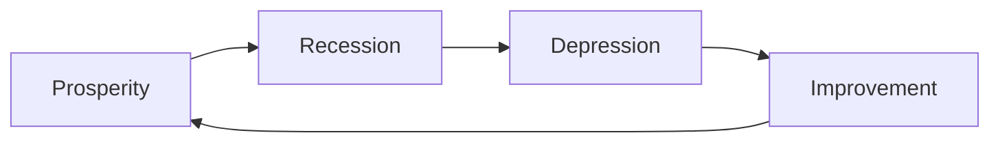
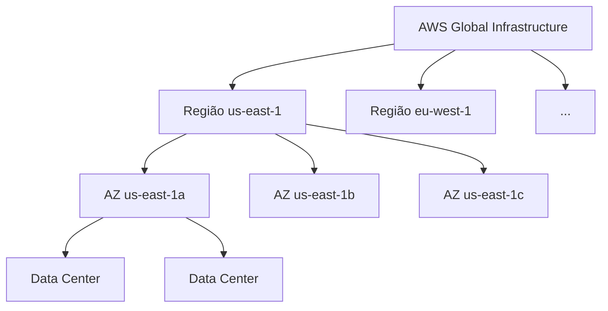

# Aula 2 — Infraestrutura Global da AWS e Conceitos de Negócio

## 🔑 Configurar MFA (Multi-Factor Authentication)

**Como ativar no root:**
1. IAM → Add MFA
2. Instalar uma aplicação autenticadora (ex.: Google Authenticator, Authy)
3. Ler o QR code
4. Inserir dois códigos consecutivos gerados pela app

> ⚠️ Recomendação de boas práticas: ativa sempre MFA na conta root e também nos utilizadores IAM com permissões elevadas.

---

## 📈 Contexto de transformação digital

*(Conceitos de negócio/gestão — não são terminologia oficial da AWS, mas podem surgir como contexto conceptual.)*

### Ondas de inovação

### Burning platform

> Conceito em que uma empresa abandona tecnologia antiga a favor de tecnologia nova, apesar da incerteza quanto ao sucesso — muitas vezes motivada pelo medo de que a sobrevivência futura da organização dependa da sua transformação digital.

---

## ⚡ Evolução do poder computacional

Medido pela velocidade a que um computador consegue completar uma tarefa computacional.

| Tipo de computação | Desempenho relativo | Serviço AWS associado |
|---|---|---|
| CPU (general computing) | Base | EC2 |
| GPU computing | ~50x mais rápido que CPU | EC2 (instâncias GPU), Inf1 |
| Quantum computing | ~100 milhões de vezes mais rápido | Amazon Braket |

> Nota: Amazon Braket é um serviço secundário para o exame — não é um tema prioritário.

---

## ✅ Vantagens da cloud

> ⚠️ Esta lista tem 7 pontos, mas o material oficial da AWS costuma apresentar **6 vantagens** (trade CAPEX por OPEX, economias de escala, parar de adivinhar capacidade, aumentar velocidade e agilidade, parar de gerir data centers, ir global em minutos). Vale a pena confirmar se esta é uma variante do mesmo conteúdo dada pelo teu curso.

| Vantagem | Descrição |
|---|---|
| **Cost effective** | Pagas apenas pelo que consomes, sem custo inicial |
| **Global** | Podes lançar workloads em qualquer parte do mundo |
| **Secure** | O provider cuida da segurança física; os serviços podem ser seguros por defeito |
| **Reliable** | Backup de dados, disaster recovery, replicação, tolerância a falhas |
| **Scalable** | Aumentas ou reduzes recursos conforme a procura |
| **Elastic** | O scaling pode ser automatizado |
| **Current** | O hardware e software subjacentes são atualizados pelo provider sem interrupção |

---

## 🌐 Infraestrutura Global da AWS

> Conjunto de hardware e data centers fisicamente interligados, distribuídos globalmente.

**Números atuais:** 39 regiões · 123 availability zones · 135+ pontos de ligação direta · 700+ pontos de presença

### Regiões

- Localizações geograficamente distintas
- Cada região é fisicamente isolada e independente das restantes (localização, energia, água)
- O custo dos serviços AWS varia por região
- Novos serviços ficam disponíveis primeiro em `us-east-1`

### Serviços regionais vs. globais

| Tipo | Descrição | Exemplos |
|---|---|---|
| **Regional** | A consola AWS fica limitada a uma região selecionada — é onde o serviço é lançado | Maioria dos serviços (ex.: EC2) |
| **Global** | Opera através de múltiplas regiões, sem região fixa selecionável | S3, CloudFront, IAM |

### Availability Zones (AZ)

- Localização física composta por um ou mais data centers
- Uma região tem geralmente **3 AZs**
- Nomenclatura: código da região + letra (ex.: `us-east-1a`)
- Todo o tráfego entre AZs é encriptado
- As AZs estão a até 100 km umas das outras

---

## 🛡️ Fault Tolerance

| Conceito | Definição |
|---|---|
| **Fault domain** | Secção da rede vulnerável a danos se um sistema crítico falhar. O objetivo é impedir que a falha se propague para fora do domínio |
| **Fault level** | Coleção de fault domains — corresponde a uma **região** |
| Relação | Fault level = Região · Fault domain = AZ |

- Cada região AWS é isolada das restantes regiões
- Cada AZ é isolada das restantes AZs, mas interligadas — cada AZ funciona como uma zona de falha independente

**Porquê usar múltiplas AZs?**
Distribuir uma aplicação por várias AZs protege melhor contra falhas de energia, trovoadas, tornados, etc.

---

## 🔗 AWS Global Network

Interligações entre toda a infraestrutura global da AWS.

### Point of Presence (PoP)

> Localização intermédia entre uma região AWS e o utilizador final — um data center (da AWS ou de um parceiro de confiança) usado para entrega de conteúdo ou upload acelerado.

| Tipo de PoP | Função |
|---|---|
| **Edge location** | Guarda cópias em cache dos ficheiros mais populares (páginas, imagens, vídeos), reduzindo a distância até ao utilizador |
| **Regional edge cache** | Guarda caches maiores de ficheiros menos populares, reduzindo round-trips e custos de transferência |

**Serviços que usam PoP:** Amazon CloudFront, Amazon S3 Transfer Acceleration, AWS Global Accelerator

### AWS Direct Connect

> Ligação privada e dedicada entre o teu data center, escritório ou colocation e a AWS.

**Direct Connect Locations** — data centers de parceiros de confiança onde é possível estabelecer uma ligação dedicada, de alta velocidade e baixa latência entre o ambiente on-premise e a AWS.

### AWS Local Zones

> Data centers localizados muito perto de uma área densamente povoada, para fornecer desempenho de baixíssima latência (single-digit millisecond) nessa área específica.

### AWS Wavelength Zones

> Permitem edge computing em redes **5G**. As aplicações que correm em Wavelength Zones têm latência ultra-baixa, ao aproximar o processamento do utilizador final que está ligado à rede móvel.

---

## 🗺️ Data Residency e Soberania de Dados

**Data residency:** localização física onde os dados ou recursos cloud de uma organização residem.

| Conceito | Definição |
|---|---|
| **Compliance boundaries** | Limites de conformidade regulatória, impostos por um governo ou organização, que definem onde os dados e recursos podem residir |
| **Data sovereignty** | Controlo jurisdicional/legal que pode ser exercido sobre os dados, porque a sua localização física está dentro de determinadas fronteiras jurisdicionais |

**AWS Outposts:** rack físico de servidores da AWS, instalado no próprio datacenter/instalações do cliente — permite correr serviços AWS on-premises, útil para cumprir requisitos de data residency.

---

## ⚙️ Governança e Controlo de Configuração

**AWS Config:** serviço de *policy as code* — permite criar regras que verificam continuamente a configuração dos recursos AWS. Pode gerar alertas ou despoletar ações automáticas quando deteta algo fora de conformidade.

**IAM Policies:** podem negar explicitamente o acesso a regiões AWS específicas.

**Service Control Policies (SCPs):** permissões aplicadas ao nível de toda a organização (AWS Organizations) — funcionam como um "teto" de permissões que se aplica a todas as contas abaixo, independentemente das políticas IAM locais de cada conta.

---

## 📝 Notas pendentes
- [ ] Confirmar se a lista de "7 vantagens" corresponde às 6 vantagens oficiais da AWS
- [ ] Rever prints mencionados nas aulas (Tier 1, Direct Connect, Amazon Braket)
- [ ] Aprofundar diferença prática entre IAM policy (deny região) vs. SCP (nível organização)

📺 *Progresso: 2h00min de vídeo assistido.*
