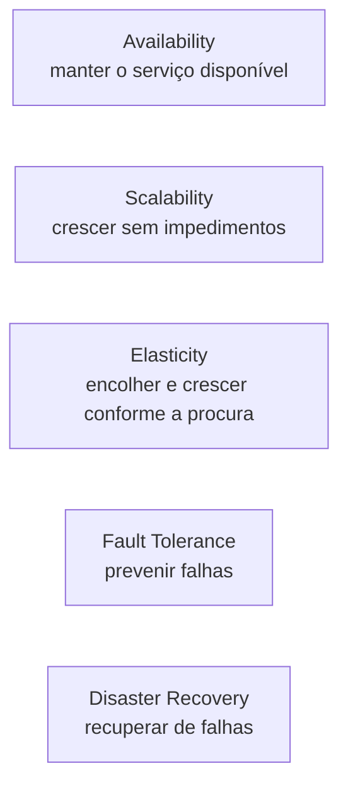
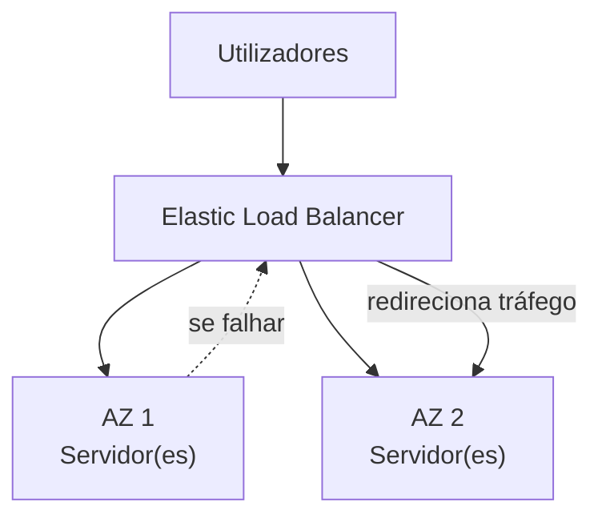
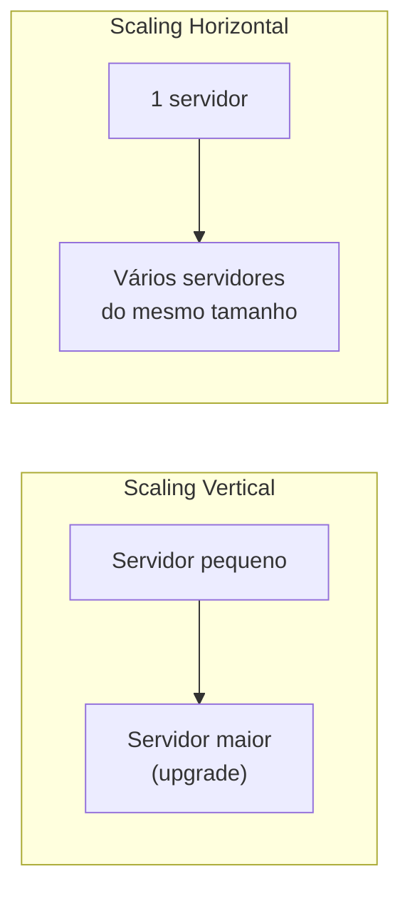
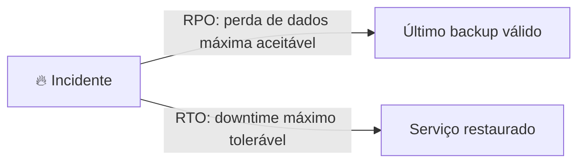

# Aula 3 — AWS para Setor Público, Sustentabilidade e Arquitetura de Alta Disponibilidade

## 🏛️ AWS for Government

**Setor público** inclui bens públicos e serviços governamentais como: militar, saúde, educação pública, transportes públicos.

### GovCloud

| Conceito | Descrição |
|---|---|
| **FedRAMP** | Programa do governo dos EUA que define uma abordagem padronizada para avaliação de segurança, autorização e monitorização contínua de serviços cloud |
| **GovCloud** | Regiões isoladas que um cloud provider disponibiliza especificamente para correr workloads sujeitos a FedRAMP |
| **AWS GovCloud** | Permite alojar informação sensível (Controlled Unclassified Information) — acessível apenas a entidades dos EUA e à respetiva conta root |

### AWS China

- Completamente **isolada** da AWS global — domínio próprio: `amazonaws.cn`
- Requer uma **licença comercial chinesa** para operar
- Duas regiões: **Ningxia** e **Beijing**

---

## 🌱 Sustentabilidade da Infraestrutura Global

- Meta: **100% energia renovável até 2025**, através de:
  - **RECs** — Renewable Energy Credits
  - **GOs** — Guarantees of Origin
- **Eficiência energética:** data centers AWS são, em média, **3,6x mais eficientes** que a média dos data centers empresariais nos EUA
- **Gestão de água:**
  - Tecnologia de arrefecimento por evaporação direta
  - Uso de água não potável para arrefecimento
  - Tratamento de água no local, para remover minerais e reutilizar a água em mais ciclos
  - Métricas de eficiência hídrica para monitorizar o uso ótimo de água por região

---

## 🛰️ AWS Ground Station

Serviço totalmente gerido que permite controlar comunicações via satélite, processar dados e escalar operações sem necessidade de construir a tua própria estação terrestre.

**Casos de uso:** previsão meteorológica, imagem de superfície, comunicações, etc.

---

## 📦 AWS Outposts

Serviço totalmente gerido que traz a mesma infraestrutura, serviços, APIs e ferramentas da AWS para (virtualmente) qualquer datacenter — na prática, é uma **rack de servidores** a correr infraestrutura AWS no teu próprio local físico.

| Tamanho | Descrição |
|---|---|
| **42U** | Rack completa de servidores fornecida pela AWS |
| **1U / 2U** | Servidores individuais que podem ser inseridos nas tuas racks já existentes |

> *Rack: estrutura desenhada para alojar e organizar equipamento informático.*

---

## 🧭 Terminologia de Arquitetura Cloud

| Papel | Foco |
|---|---|
| **Solutions Architect** | Desenha uma solução técnica usando múltiplos sistemas, através de investigação, documentação e experimentação |
| **Cloud Architect** | Foca-se exclusivamente em arquitetar soluções técnicas usando serviços cloud |

### Os 5 pilares que o Cloud Architect tem de garantir



Um Solutions Architect deve sempre considerar dois fatores de negócio:
1. **Quão segura é a solução?**
2. **Quanto é que isto vai custar?**

---

## 🟢 High Availability (Alta Disponibilidade)

Garantir que o serviço permanece disponível, eliminando pontos únicos de falha e/ou mantendo um certo nível de desempenho.

- Correr workloads em **múltiplas AZs** — se uma AZ ficar indisponível, a app continua a funcionar
- **Elastic Load Balancer (ELB):** distribui tráfego de forma equilibrada por múltiplos servidores, num ou mais datacenters. Se um datacenter ficar indisponível, o load balancer redireciona o tráfego para outro



---

## 📈 High Scalability

Capacidade de aumentar a capacidade em resposta ao aumento de tráfego, memória e poder computacional.



| Tipo | Descrição |
|---|---|
| **Vertical** | Upgrade para um servidor maior (mais CPU/RAM na mesma máquina) |
| **Horizontal** | Adicionar mais servidores do mesmo tamanho |

---

## 🔄 High Elasticity

Aumentar ou reduzir a capacidade **automaticamente**, com base na procura atual.

- **Scaling out** (horizontal): adicionar mais servidores
- **Scaling in** (horizontal): remover servidores subutilizados
- ⚠️ Scaling **vertical não se usa** com elasticidade — só faz sentido com scaling horizontal

**Auto Scaling Groups (ASG):** funcionalidade da AWS que adiciona ou remove servidores automaticamente, com base em regras de scaling definidas por ti, usando métricas.

---

## 🛡️ Fault Tolerance

Ausência de ponto único de falha — previne a possibilidade de falha.

- **Failover:** plano para redirecionar tráfego para um sistema redundante, caso o sistema primário falhe
  - Ter uma cópia (secundária) da base de dados, que só entra em uso se ocorrer um failover
- **RDS Multi-AZ:** corres uma base de dados standby duplicada noutra AZ, para o caso da base de dados primária falhar

---

## 💾 High Durability

Capacidade de recuperar de um desastre e prevenir a perda de dados. A solução para isto chama-se **Disaster Recovery (DR)**.

Perguntas-chave sobre backups:
- Fazes backup?
- Quão rápido consegues restaurar esse backup?
- O backup continua a funcionar (foi testado)?

**AWS Elastic Disaster Recovery (antigo CloudEndure DR):** replica continuamente as tuas máquinas para uma área de staging de baixo custo, na conta e região AWS de destino que preferires, permitindo uma recuperação rápida e fiável.

---

## 📄 Business Continuity Plan (BCP)

Documento que define como o negócio vai continuar a operar durante uma interrupção não planeada dos serviços.



| Métrica | Definição |
|---|---|
| **RPO** (Recovery Point Objective) | Quantidade máxima de perda de dados aceitável após um incidente, expressa em tempo |
| **RTO** (Recovery Time Objective) | Tempo máximo de downtime que o negócio consegue tolerar sem sofrer uma perda financeira significativa |

> 📌 *Opções de disaster recovery — ver print da aula (backup & restore, pilot light, warm standby, multi-site ativo/ativo).*

---

## 🧰 Ferramentas e Conceitos de Gestão AWS

### AWS API
Software através do qual duas aplicações comunicam entre si via HTTP/S.

### AWS Management Console
Consola web unificada para construir, gerir e monitorizar tudo na tua conta AWS.

### Service Console
Cada serviço AWS tem a sua própria consola personalizada — acessível pesquisando pelo nome do serviço.

### AWS Account ID
Cada conta AWS tem um ID único, usado para:
- Login com utilizador non-root
- Acesso cross-account
- Definição de roles (ex.: dar acesso a um serviço apenas a uma conta com ID específico)
- Support cases

### AWS Tools for PowerShell
- **PowerShell:** shell de linha de comandos e linguagem de scripting para automação e configuração de tarefas
- **AWS Tools for PowerShell:** permite interagir com a API da AWS através de cmdlets do PowerShell

### Amazon Resource Name (ARN)
Identifica de forma única qualquer recurso AWS.

```
arn:partition:service:region:account-id:resource-id
arn:partition:service:region:account-id:resource-type/resource-id
```


exemplo:
arn:aws:ec2:eu-north-1:324567123432:instance/i-0c214be854f0ca5a5
---

📺 *Progresso: 3h05min de vídeo assistido.*