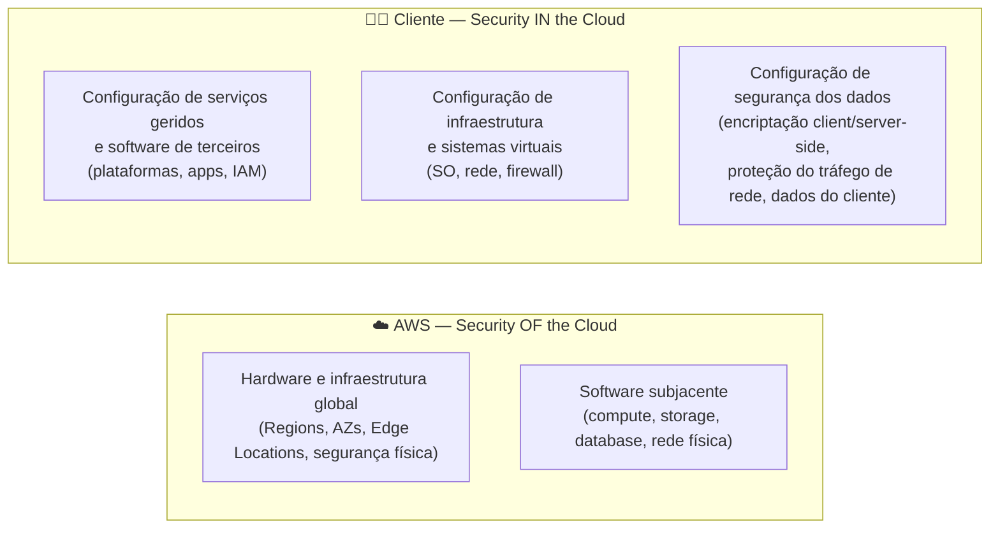
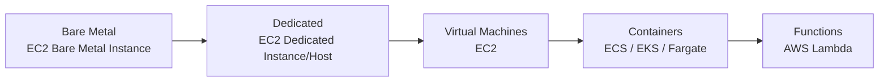

# Aula 4 — Ferramentas AWS, IaC e Shared Responsibility Model

## 💻 AWS CLI

| Termo | Definição |
|---|---|
| **Terminal** | Interface só de texto |
| **Console** | Computador físico usado para introduzir informação fisicamente num terminal |
| **Shell** | Programa de linha de comandos com o qual o utilizador interage para inserir comandos (ex.: PowerShell, Bash) |
| **AWS CLI** | Interface de linha de comandos para interagir com a API da AWS, através de comandos de uma ou várias linhas |

> 💡 É possível usar a AWS CLI diretamente no VS Code — basta instalar a extensão da AWS.

### AWS SDK

**Software Development Kit (SDK):** coleção de ferramentas de desenvolvimento de software reunidas num único pacote instalável.

O **AWS SDK** permite criar, modificar, apagar ou interagir com recursos AWS de forma **programática** (via código).

### AWS CloudShell

Shell baseado no browser, embutido diretamente na AWS Management Console — não precisas de instalar nada localmente.

---

## 🏗️ Infrastructure as Code (IaC)

Escrever um script de configuração para automatizar a criação, atualização ou destruição de infraestrutura cloud. Vantagens: facilita partilhar, versionar e inventariar a infraestrutura.

| Ferramenta | Características |
|---|---|
| **AWS CloudFormation (CFN)** | Ficheiros YAML (linguagem simples), mas pode resultar em ficheiros grandes. É possível carregar um template `.yml` na consola do CloudFormation para validar erros antes de correr |
| **AWS CDK** (Cloud Development Kit) | Permite escrever IaC em qualquer linguagem de programação (Python, Node.js, Java, etc.). Tem biblioteca extensa, CLI própria, pipelines para configurar CI/CD rapidamente, e framework de testes para testes unitários e de integração |

---

## 🧩 AWS Toolkit for VS Code

Plugin open-source para VS Code que permite criar, debugar e fazer deploy de recursos AWS diretamente no editor.

| Funcionalidade | Descrição |
|---|---|
| **AWS Explorer** | Explora uma grande variedade de recursos AWS associados à tua conta |
| **AWS CDK Explorer** | Explora as tuas stacks definidas com o CDK |
| **Amazon ECS support** | Fornece IntelliSense (autocompletar + descrições) para ficheiros de task definition do ECS |
| **Serverless Applications** | Cria, debuga e faz deploy de aplicações serverless |

---

## 🔑 Access Keys

Chave (access key) + segredo (secret key), necessários para ter **acesso programático** aos recursos AWS ao interagir com a API fora da Management Console.

- Também chamadas de **AWS credentials**
- Cada utilizador pode ter **2 chaves ativas** em simultâneo
- Podem ser **desativadas** quando necessário
- ⚠️ Quem usa a chave tem **exatamente as mesmas permissões** do utilizador associado a ela
- Guardadas localmente em `~/.aws/credentials`

### AWS Documentation
Grande coleção de documentação técnica sobre como usar os serviços AWS — a fonte de referência oficial para tudo.

---

## 🛡️ Shared Responsibility Model

Framework de segurança cloud que define as obrigações de segurança do **cliente** vs. do **cloud provider** (ex.: AWS).

> 🟢 **AWS** é responsável pela **segurança DA cloud**.
> 🔵 **O cliente** é responsável pela **segurança NA cloud**.

**Regra prática (das duas definições do print):**
- **Responsabilidade "IN the cloud":** se conseguires configurar ou armazenar algo, tu (cliente) és responsável por isso.
- **Responsabilidade "OF the cloud":** se não conseguires configurar algo, a AWS é responsável por isso.

---

## 🧱 Tipos de Responsabilidade na Cloud Computing

Como a responsabilidade se distribui ao longo da stack, consoante o modelo de serviço:

| Camada | On-Premise | IaaS | PaaS | SaaS |
|---|:---:|:---:|:---:|:---:|
| Applications | 🔵 Cliente | 🔵 Cliente | 🔵 Cliente | 🟠 AWS |
| Data | 🔵 Cliente | 🔵 Cliente | 🔵 Cliente | 🟠 AWS |
| Runtime | 🔵 Cliente | 🔵 Cliente | 🟠 AWS | 🟠 AWS |
| Middleware | 🔵 Cliente | 🔵 Cliente | 🟠 AWS | 🟠 AWS |
| OS | 🔵 Cliente | 🔵 Cliente | 🟠 AWS | 🟠 AWS |
| Virtualization | 🔵 Cliente | 🟠 AWS | 🟠 AWS | 🟠 AWS |
| Servers | 🔵 Cliente | 🟠 AWS | 🟠 AWS | 🟠 AWS |
| Storage | 🔵 Cliente | 🟠 AWS | 🟠 AWS | 🟠 AWS |
| Networking | 🔵 Cliente | 🟠 AWS | 🟠 AWS | 🟠 AWS |

> 📌 Padrão a memorizar: **On-Premise** → tudo é teu. **IaaS** → tu geres a partir do SO para cima. **PaaS** → tu geres só a app e os dados. **SaaS** → só usas, não configuras nada.

---

## 🖥️ Shared Responsibility Model — Compute

À medida que avanças de **Bare Metal** para **Functions**, a AWS assume progressivamente mais responsabilidade e tu (cliente) cada vez menos:

**Camadas afetadas ao longo do espectro:** Código → App Container → Runtime → OS → Virtualização.
- **Código:** é sempre responsabilidade do cliente, em qualquer ponto do espectro.
- **Virtualização:** é (quase) sempre responsabilidade da AWS, em qualquer ponto do espectro.
- **App Container, Runtime, OS:** a responsabilidade vai-se transferindo do cliente para a AWS à medida que avanças de Bare Metal para Functions.

### Comparação detalhada por tipo de compute

| Tipo | Exemplo AWS | Responsabilidade do **Cliente** | Responsabilidade da **AWS** |
|---|---|---|---|
| **IaaS — Bare Metal** | EC2 Bare Metal Instance | Configuração do Host OS, Hypervisor | Máquina física |
| **IaaS — Virtual Machine** | EC2 | Configuração do Guest OS, runtime de containers | Hypervisor, máquina física |
| **IaaS — Containers** | Amazon ECS | Configuração, deployment e storage dos containers | OS, hypervisor, runtime de containers |
| **PaaS** | AWS Elastic Beanstalk | Upload do código, configuração do ambiente, estratégias de deployment, configuração de serviços associados | Servidores, OS, rede, storage, segurança |
| **SaaS** | Amazon WorkDocs | Conteúdo dos documentos, gestão de ficheiros, configuração de partilha/acesso | Servidores, OS, rede, storage, segurança |
| **FaaS** | AWS Lambda | Apenas o upload do código | Praticamente tudo: deployment, runtime, rede, storage, segurança, máquina física |

---

## 🏛️ Shared Responsibility Model — Arquitetura

Quanto mais próximo do **serverless**, menos responsabilidade tens — mas também menos controlo direto:

| Nível de responsabilidade | Estilo de arquitetura | Serviços AWS | Características |
|---|---|---|---|
| 🟢 **Menos responsabilidade** | Serverless / Functions | Lambda, Amplify | Não há servidores a gerir — só te preocupas com dados e código |
| 🟡 **Responsabilidade intermédia** | Microservices / Containers | Fargate, ECS, EKS | Combinas linguagens diferentes, melhor aproveitamento de recursos |
| 🔴 **Mais responsabilidade** | Traditional / VMs | Elastic Beanstalk (PaaS), EC2 (IaaS) | Arquitetura mais familiar globalmente — muita documentação, frameworks e suporte disponíveis |

---

## 📊 Shared Responsibility Model — Detalhe por Camada e Modelo

Visualização que ajuda a determinar exatamente o que o **cliente** e o que a **AWS (CSP)** são responsáveis, por camada e por modelo de serviço:

| Camada | IaaS | PaaS | SaaS |
|---|:---:|:---:|:---:|
| Content | 🔵 Cliente | 🔵 Cliente | 🔵 Cliente |
| Access Policies | 🔵 Cliente | 🔵 Cliente | 🔵 Cliente |
| Usage | 🔵 Cliente | 🔵 Cliente | 🔵 Cliente |
| Deployment | 🔵 Cliente | 🔵 Cliente | 🟠 AWS |
| Web application security | 🔵 Cliente | 🔵 Cliente | 🟠 AWS |
| Identity | 🔵 Cliente | 🟠 AWS | 🟠 AWS |
| Operations | 🔵 Cliente | 🟠 AWS | 🟠 AWS |
| Access and authentication | 🔵 Cliente | 🟠 AWS | 🟠 AWS |
| Network security | 🔵 Cliente | 🟠 AWS | 🟠 AWS |
| Guest OS, data & content | 🔵 Cliente | 🟠 AWS | 🟠 AWS |
| Audit logging | 🟠 AWS | 🟠 AWS | 🟠 AWS |
| Network | 🟠 AWS | 🟠 AWS | 🟠 AWS |
| Storage + encryption | 🟠 AWS | 🟠 AWS | 🟠 AWS |
| Hardened Kernel + IPC | 🟠 AWS | 🟠 AWS | 🟠 AWS |
| Boot | 🟠 AWS | 🟠 AWS | 🟠 AWS |
| Hardware | 🟠 AWS | 🟠 AWS | 🟠 AWS |

> 📌 Repara no padrão: à medida que avanças de IaaS → PaaS → SaaS, a "linha divisória" sobe — a AWS absorve cada vez mais camadas, e o cliente fica só com o topo (conteúdo, políticas de acesso e utilização).

---

📺 *Progresso: 4h20min de vídeo assistido.*