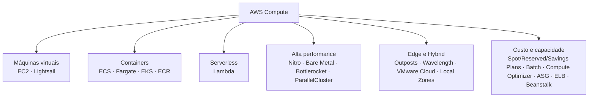
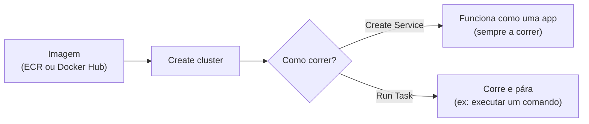

# Aula 5 — Computing Services

## 🗺️ Mapa geral dos serviços de compute

---

## 💻 Amazon EC2 (Elastic Compute Cloud)

Lança uma **máquina virtual**, chamada de **instância**.

- **Máquina virtual:** emulação de um computador físico através de software.
- **Virtualização de servidores:** permite criar, copiar, redimensionar ou migrar servidores facilmente.

EC2 é um servidor **altamente configurável**. Podes escolher:

| Opção | Exemplo |
|---|---|
| AMI (Amazon Machine Image) | Imagem base com SO e software |
| CPU e RAM | Tamanho da instância |
| Largura de banda de rede | Desempenho de rede |
| Sistema operativo | Linux, Windows, etc. |
| Armazenamento | Vários discos virtuais anexados (ex.: **EBS** — Elastic Block Store) |

---

## 🧰 Serviços de Compute

| Serviço | O que é |
|---|---|
| **Amazon Lightsail** | Servidor virtual gerido; a versão "amigável" do EC2 |
| **Containers** | Virtualização do sistema operativo para correr múltiplos workloads numa única instância |
| **ECS** (Elastic Container Service) | Serviço de orquestração de containers com suporte a Docker. Lança um cluster de servidores em instâncias EC2 com Docker instalado |
| **ECR** (Elastic Container Registry) | Repositório de imagens de containers, com controlo de versões |
| **ECS Fargate** | Orquestração de containers **serverless**. Igual ao ECS, mas pagas **por container em execução** |
| **EKS** (Elastic Kubernetes Service) | Kubernetes totalmente gerido. Kubernetes é software open-source de orquestração criado pela Google, geralmente o padrão para gerir microservices |
| **Lambda** | Serviço de funções serverless: corres código sem provisionar ou gerir servidores |

### ECS vs. Fargate

| | ECS (com EC2) | ECS com Fargate |
|---|---|---|
| Servidores | Tens de manter um servidor EC2 ligado, mesmo sem containers a correr | A AWS gere o servidor subjacente |
| Escalar/atualizar | Por tua conta | Não precisas de escalar nem atualizar o EC2 |
| Pagamento | Pelo servidor EC2 | On-demand, por container em execução |

### Lambda

Fazes upload de um pequeno pedaço de código e defines:
- Quanta **memória** usa
- Quanto **tempo** a função pode correr antes de dar timeout

---

## 🛠️ Na prática: ECS e Lambda

### ECS

**Task definition** — é preciso definir:
- Um nome
- CPU e memória para a task
- A imagem do container (Docker Hub ou ECR)
- Portas a abrir

### Lambda

1. Escolhes a **linguagem** do código
2. Cola o código (simples) ou carrega um **.zip** do projeto ou a partir de um **bucket S3**
3. Clica **Deploy**
4. Testa

---

## 🚀 Serviços de Alta Performance

### Nitro System

Hardware dedicado + hypervisor leve. Permite inovação mais rápida e segurança reforçada.

| Componente | Função |
|---|---|
| **Nitro Cards** | Placas especializadas para VPC, EBS e instance storage |
| **Nitro Security Chips** | Integrados na motherboard, protegem os recursos de hardware |
| **Nitro Hypervisor** | Hypervisor leve, gere a alocação de memória e CPU |

### Outros serviços

| Serviço | Descrição |
|---|---|
| **Bare Metal Instance** | Instância EC2 **sem hypervisor**: corres workloads diretamente no hardware, para máxima performance e controlo (ex.: famílias M5 e R5 têm variantes bare metal) |
| **Bottlerocket** | SO Linux open-source, criado pela AWS especificamente para correr containers em VMs ou bare metal |
| **AWS ParallelCluster** | Ferramenta open-source de gestão de clusters, facilita o deploy e gestão de clusters de high performance computing (HPC) na AWS |

---

## 🌍 Edge e Hybrid Computing

- **Edge computing:** empurras os workloads para fora da tua rede, para correrem perto do destino/utilizador final.
- **Hybrid computing:** corres workloads tanto no teu datacenter on-premise como numa AWS VPC.

| Serviço | Descrição |
|---|---|
| **AWS Outposts** | Rack física de servidores que colocas no teu datacenter |
| **AWS Wavelength** | Construir e lançar aplicações num datacenter de telecom, com latência ultra-baixa via rede 5G, o mais perto possível do utilizador |
| **VMware Cloud on AWS** | Gerir máquinas virtuais VMware on-premise a correr na AWS. O datacenter tem de usar VMware para virtualização |
| **AWS Local Zones** | Datacenters edge fora das regiões AWS, para usar a AWS mais perto do destino final |

---

## 💰 Gestão de Custo e Capacidade

- **Cost management:** como poupar dinheiro?
- **Capacity management:** como responder à procura de tráfego e utilização, adicionando ou melhorando servidores?

### Formas de poupar em compute

**EC2 Spot Instances, Reserved Instances e Savings Plans:** formas de poupar em compute pagando adiantado (total ou parcialmente), comprometendo-te com contratos anuais, ou sendo flexível quanto à disponibilidade e interrupções do serviço.

### Outros serviços

| Serviço | Descrição |
|---|---|
| **AWS Batch** | Planeia, agenda e executa workloads de batch computing em toda a gama de serviços de compute da AWS |
| **AWS Compute Optimizer** | Sugere como reduzir custos e melhorar performance, usando machine learning para analisar o teu histórico de utilização |
| **EC2 Auto Scaling Groups (ASG)** | Adiciona ou remove servidores EC2 automaticamente conforme a procura. Poupas dinheiro e cumpres a capacidade, porque só corres os servidores de que precisas |
| **Elastic Load Balancer (ELB)** | Distribui tráfego por várias instâncias, redireciona de instâncias com falhas (unhealthy) para saudáveis, e pode distribuir por diferentes AZs |
| **AWS Elastic Beanstalk (EB)** | Facilita o deploy de aplicações web sem que os developers tenham de configurar ou compreender os serviços AWS subjacentes |

---

📺 *Progresso: 5h12min de vídeo assistido.*