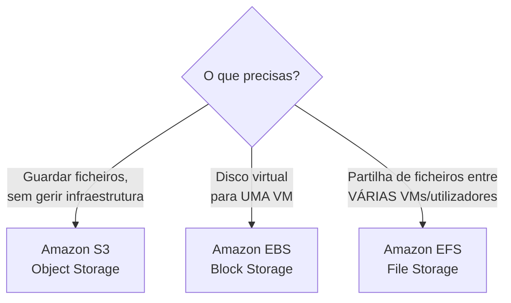
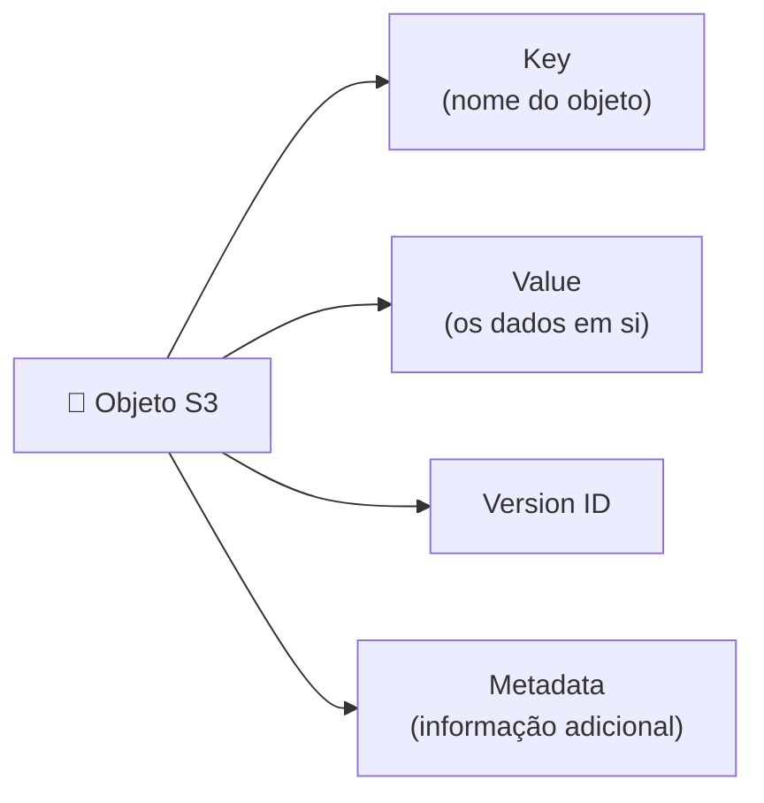
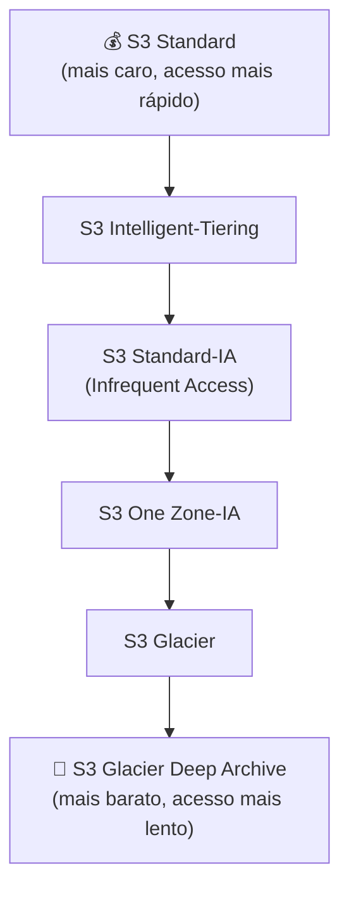
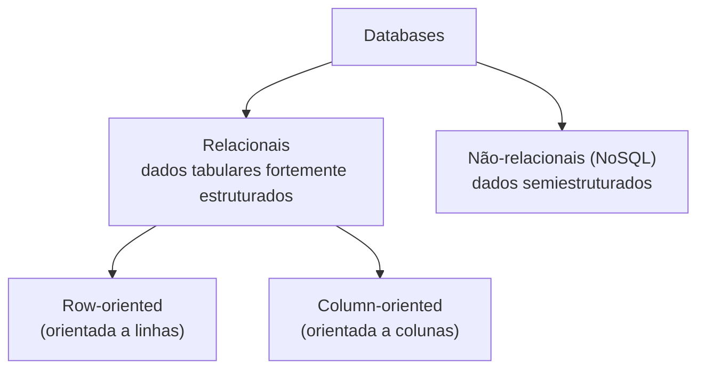
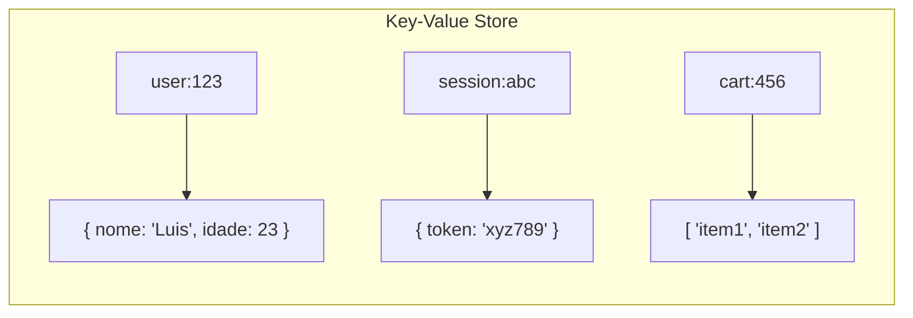

# Aula 6 — Storage e Databases

# 📦 PARTE 1 — STORAGE

## Tipos de storage: qual escolher?



| Serviço | Quando usar | Características |
|---|---|---|
| **S3** | Fazer upload de ficheiros, sem te preocupares com a infraestrutura subjacente | Não indicado para IOPS elevados; sem limite de número de ficheiros; suporta múltiplas leituras e escritas em simultâneo |
| **EBS** | Precisas de um disco rígido virtual anexado a uma VM | Suporta apenas **um volume de escrita** (uma instância de cada vez); acesso direto pelo SO |
| **EFS** | Vários utilizadores ou VMs precisam de aceder à **mesma** drive (shared folders) | Ligações múltiplas via rede; suporta múltiplas leituras; a escrita bloqueia o ficheiro (file locking) |

---

## Amazon S3

**Object storage (armazenamento por objetos):** gere os dados como **objetos**, ao contrário de outras arquiteturas de storage:

| Arquitetura | Como organiza os dados |
|---|---|
| **File systems** | Ficheiros organizados numa hierarquia de pastas |
| **Block storage** | Dados em blocos, dentro de setores e tracks (como um disco rígido) |
| **Object storage (S3)** | Dados como objetos independentes, sem hierarquia real |

> S3 tem storage **ilimitado**. A consola do S3 fornece uma interface para fazeres upload e aceder aos dados.

### Anatomia de um objeto S3



### Bucket

- **Bucket:** contentor que guarda objetos (e pode ter "pastas" que, por sua vez, guardam objetos).
- Tem um **namespace universal** — o nome do bucket tem de ser **único a nível global**, em toda a AWS.
- Storage ilimitado no bucket, mas **cada objeto individual tem um limite de 5 TB**.

---

## S3 Storage Classes

A AWS oferece várias classes de storage, que trocam **velocidade de acesso e disponibilidade** por **custo mais baixo**:



| Classe | Ideal para |
|---|---|
| **S3 Standard** | Dados acedidos frequentemente |
| **S3 Intelligent-Tiering** | Padrões de acesso desconhecidos ou imprevisíveis — a AWS move os dados automaticamente entre camadas |
| **S3 Standard-IA** | Dados acedidos com pouca frequência, mas que precisam de acesso rápido quando necessário |
| **S3 One Zone-IA** | Como o Standard-IA, mas guardado numa **única AZ** (mais barato, menos resiliente) |
| **S3 Glacier** | Arquivo a longo prazo, recuperação em minutos/horas |
| **S3 Glacier Deep Archive** | Arquivo muito raramente acedido, recuperação em horas — a opção mais barata de todas |

---

## AWS Snow Family

Dispositivos de storage e compute usados para **mover fisicamente** dados de/para a cloud, quando a transferência pela rede seria demasiado lenta.

| Dispositivo | Tamanho | Capacidade |
|---|---|---|
| **Snowcone** | Muito pequeno (tipo mala pequena) | 8 TB HDD / 14 TB SSD |
| **Snowball Edge** | Tamanho de mala | Storage optimized: 80 TB · Compute optimized: 39,5 TB |
| **Snowmobile** | Contentor transportado por camião semirreboque | 100 PB por reboque |

> 📌 Padrão a memorizar: **Snowcone** (mini) → **Snowball/Snowball Edge** (mala, dezenas de TB) → **Snowmobile** (contentor inteiro, petabytes).

---

## Serviços de Storage — resumo detalhado

### Amazon S3
Serviço de object storage **serverless**. Uploads de ficheiros grandes, quantidade ilimitada de ficheiros. Pagas pelo que armazenas, sem te preocupares em aumentar o tamanho do disco ou gerir o sistema de ficheiros subjacente.

- **URLs pré-assinados:** podes gerar um URL para partilhar dados com outras pessoas, definindo um tempo de expiração para o download.
- **Bucket policy:** define quem pode (ou não) aceder, e a que ficheiros.
- **Lifecycle rules:** ações automáticas sobre os objetos, por exemplo:
  - Apagar versões não-atuais de objetos
  - Mover versões atuais para outras storage classes
  - Apagar objetos expirados

### Amazon S3 Glacier
Serviço de **cold storage** — armazenamento de baixo custo para arquivo e backups de longo prazo. Usa discos HDD; altamente seguro e durável.

### Amazon EBS (Elastic Block Store)
Serviço de **block storage persistente** — disco rígido virtual na cloud, anexado a instâncias EC2. Vários tipos de disco disponíveis: SSD, IOPS SSD, HDD, etc.

### Amazon EFS (Elastic File System)
Serviço de sistema de ficheiros **NFS nativo da cloud**. Storage de ficheiros que podes montar em **múltiplas instâncias EC2** — usa quando precisas de partilhar ficheiros entre vários servidores.

> Fluxo típico: criar um **access point** e configurá-lo na EC2 → fica disponível na pasta `/mnt`.

### AWS Storage Gateway
Serviço de storage **híbrido** que estende o teu storage on-premise para a cloud.

| Tipo de gateway | Função |
|---|---|
| **File Gateway** | Estende o teu storage local para o Amazon S3 |
| **Volume Gateway** | Faz cache das tuas drives locais no S3, mantendo um backup contínuo dos ficheiros locais na cloud |
| **Tape Gateway** | Guarda ficheiros em **tapes virtuais**, para backups a longo prazo com custo muito reduzido |

### AWS Backup
Serviço de backup **gerido**, que centraliza e automatiza o backup de dados em vários serviços AWS: **EC2, EBS, RDS, DynamoDB, EFS, Storage Gateway**.

### AWS Elastic Disaster Recovery (antigo CloudEndure DR)
Replica continuamente as tuas máquinas para uma área de staging de baixo custo, na conta e região AWS de destino, permitindo uma recuperação rápida e fiável.

### Amazon FSx
Sistemas de ficheiros ricos em funcionalidades e de alta performance.

| Variante | Descrição |
|---|---|
| **FSx for Windows File Server** | Usa o protocolo **SMB**, permite montar em servidores Windows |
| **FSx for Lustre** | Usa o sistema de ficheiros **Lustre** (Linux), permite montar em servidores Linux — muito usado em workloads de HPC/machine learning |

---

# 🗄️ PARTE 2 — DATABASES

## Visão geral

Uma base de dados guarda dados **estruturados** ou **semiestruturados**, usando técnicas formais de design e modelação.



| Tipo | Descrição |
|---|---|
| **Relacional** | Dados estruturados, fortemente tabulares. Pode ser orientada a linhas ou a colunas |
| **Não-relacional (NoSQL)** | Dados semiestruturados, que podem ou não parecer-se remotamente com uma tabela |

---

## Data Warehouse

Desenhado para **workloads analíticos** — normalmente um data store orientado a colunas.

- Faz **agregação** dos dados (agrupar dados).
- Colunas otimizadas para leitura.
- É **"HOT"**: devolve resultados de queries muito rapidamente.

---

## Key-Value Store (explicado em detalhe)

Um **key-value store** é um tipo de base de dados não-relacional (NoSQL) que guarda dados de forma extremamente simples: a cada **chave (key)** única corresponde um **valor (value)** — normalmente um blob opaco de dados (texto, JSON, binário).



**Como funciona na prática:** para ler um valor, dás a chave exata (ex.: `GET user:123`) e recebes o valor associado — não há "procurar por partes do valor" nem relações entre chaves.

| Característica | Explicação |
|---|---|
| ⚡ **Rápido** | Como a pesquisa é feita diretamente pela chave (como um dicionário/hash map), as operações são extremamente rápidas — normalmente O(1) |
| 🧠 **"Dumb" (simples)** | Não entende a estrutura do valor — para o key-value store, o valor é só um bloco de dados opaco |
| 📈 **Escala facilmente** | Fácil de distribuir por muitos servidores, porque não há relações complexas a manter entre registos |
| ❌ **Sem relações** | Não existem "joins" entre diferentes conjuntos de dados, como numa base de dados relacional |
| ❌ **Sem índices secundários avançados** | Normalmente só conseguem pesquisar pela chave principal, não por campos dentro do valor |
| ❌ **Sem agregações nativas** | Operações como `SUM`, `GROUP BY`, `COUNT` não são o forte deste tipo de base de dados |

**Quando usar:** sessões de utilizador, carrinhos de compras, caches, perfis simples de utilizador — sempre que o acesso é feito quase sempre "dá-me o valor desta chave" e não precisas de fazer perguntas complexas aos dados.

**Exemplo AWS:** Amazon DynamoDB (no modo key-value) e Amazon ElastiCache (Redis/Memcached).

---

## Document Store

Base de dados NoSQL que guarda **documentos** como estrutura de dados principal. Um documento pode ser XML, JSON, ou "JSON-like" (formato semelhante ao JSON).

> Ao contrário do key-value store puro, um document store **entende a estrutura interna** do documento — por isso consegue fazer queries a campos específicos dentro do documento (ex.: "todos os utilizadores com `idade > 18`").

---

## Serviços de Base de Dados NoSQL

| Serviço | Descrição | Quando usar |
|---|---|---|
| **DynamoDB** | Base de dados NoSQL **serverless**, key-value e document. Desenhada para escalar a milhares de milhões de registos, com retorno de dados consistente em menos de um segundo. Não te preocupas em gerir *shards* | Quando queres uma base de dados massivamente escalável, económica e muito rápida |
| **DocumentDB** | Base de dados de documentos NoSQL, **compatível com MongoDB** | Quando queres uma base de dados tipo MongoDB, gerida pela AWS |
| **Amazon Keyspaces** | Apache Cassandra totalmente gerido | Quando queres usar Apache Cassandra sem gerir a infraestrutura |

> 💡 **DynamoDB — PartiQL editor:** permite escrever comandos tipo SQL para filtrar e obter dados, por exemplo:
> ```sql
> SELECT * FROM users WHERE name = 'luis'
> ```

---

## Serviços de Base de Dados Relacional

### Amazon RDS (Relational Database Service)
O tipo de base de dados **mais usado**. Suporta múltiplos motores SQL: **MySQL, MariaDB, PostgreSQL, Oracle, Microsoft SQL Server, Aurora**.

| Aspeto configurável | Detalhe |
|---|---|
| **Gestão de credenciais** | Auto-gerida — password master |
| **Configuração da instância** | Quantos CPU, RAM, largura de banda de rede |
| **Storage** | Tipo de disco (SSD, etc.) |
| **Ligação à EC2** | Opcional — ligar ou não uma instância EC2 à base de dados |
| **RDS Proxy** | Usado, por exemplo, pelo Lambda, para gerir pedidos de pull/push à base de dados de forma eficiente |

### Amazon Aurora
Base de dados totalmente gerida — **5x mais rápida** que o MySQL e **3x mais rápida** que o PostgreSQL.

> Usa quando queres uma base de dados relacional altamente disponível, durável, escalável e segura, compatível com PostgreSQL ou MySQL.

### Aurora Serverless
Versão **on-demand e serverless** do Aurora.

> Usa quando queres a maioria dos benefícios do Aurora, mas estás disposto a aceitar *cold starts*, ou não tens tráfego elevado constante.

### RDS on VMware
Permite fazer deploy dos motores suportados pelo RDS num datacenter **on-premise**. O datacenter tem de usar VMware para virtualização.

> Usa quando queres bases de dados geridas pelo RDS, mas no teu próprio datacenter.

---

## Outros serviços de bases de dados

| Serviço | Tipo | Quando usar |
|---|---|---|
| **Amazon Redshift** | Data warehouse à escala de petabytes | Gerar analytics ou relatórios rapidamente a partir de grandes volumes de dados |
| **Amazon ElastiCache** | Base de dados em memória / caching (Redis ou Memcached), gerida | Melhorar a performance de uma aplicação, adicionando uma camada de cache à frente do servidor web ou da base de dados |
| **Amazon Neptune** | Base de dados de grafos gerida | Compreender ligações entre dados — ex.: mapear redes de fraude ou relações em redes sociais |
| **Amazon Timestream** | Base de dados de séries temporais gerida | Medir como algo muda ao longo do tempo |
| **Amazon QLDB** (Quantum Ledger Database) | Base de dados de livro-razão (ledger) gerida — logs de transações transparentes, imutáveis e criptograficamente verificáveis | Registar histórico de atividades financeiras que precisa de ser confiável |
| **AWS DMS** (Database Migration Service) | Serviço de migração de bases de dados | On-premise → AWS; entre duas bases de dados (mesma ou diferente conta AWS) com motores SQL diferentes; ou até de SQL para NoSQL |

---

📺 *Progresso: 6h28min de vídeo assistido.*