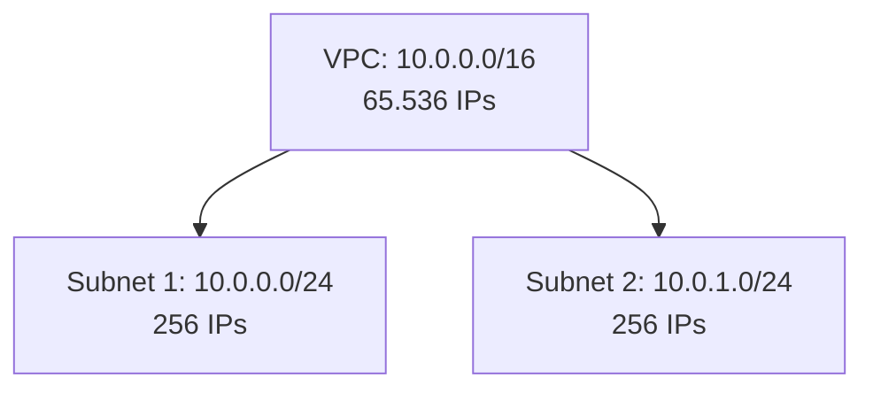
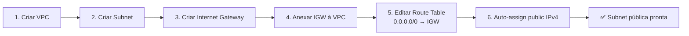
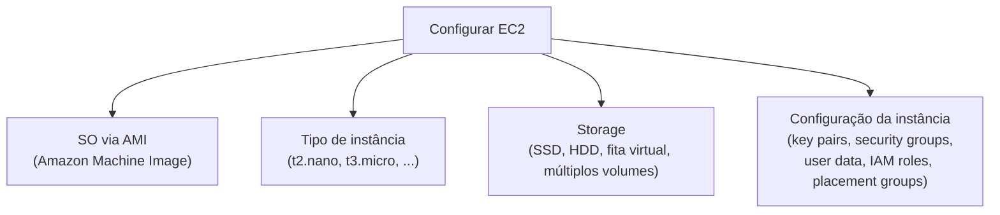
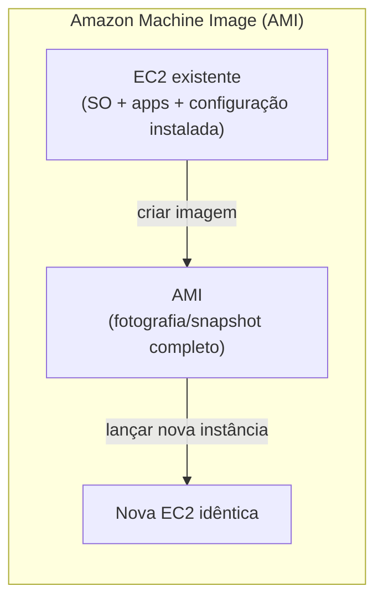

# Aula 7 — Networking e EC2 em Detalhe

# 🌐 PARTE 1 — NETWORKING

## Serviços de rede nativos da cloud

| Serviço | O que faz |
|---|---|
| **VPC** (Virtual Private Cloud) | Secção logicamente isolada da AWS onde lanças os teus recursos |
| **Internet Gateway (IGW)** | Permite o acesso à internet |
| **Route Tables** | Determinam para onde é encaminhado o tráfego de rede das subnets |
| **Region** | Localização geográfica da tua rede |
| **AZ** (Availability Zone) | O(s) datacenter(s) onde os teus recursos AWS residem |
| **Subnet** | Partição lógica de uma rede IP em segmentos mais pequenos |
| **NACL** | Firewall ao nível da **subnet** |
| **Security Group** | Firewall ao nível da **instância** |

### Diagrama de rede

ver print diagrama de rede

> 📌 Repara na hierarquia: **Conta AWS → Region → VPC → Availability Zone → Subnet (pública/privada) → NACL → Route Table → Security Group → Recurso (EC2, RDS, ...)**. O tráfego que vem da internet passa sempre pelo Internet Gateway antes de chegar a uma subnet pública.

---

## Enterprise / Hybrid Networking

| Serviço | Função |
|---|---|
| **AWS VPN** (Virtual Private Network) | Ligação segura entre o on-premise, escritórios remotos e colaboradores móveis |
| **AWS Direct Connect** | Ligação dedicada de gigabits, do datacenter on-premise até à AWS — muito rápida |
| **AWS PrivateLink** (VPC Interface Endpoints) | Mantém o tráfego **dentro da rede AWS**, sem atravessar a internet pública — mais seguro |

---

## VPC e Subnets

**VPC:** secção logicamente isolada da AWS onde lanças recursos. Escolhes um intervalo de IPs através de um **CIDR range**.

```
Exemplo: 10.0.0.0/16 → 65.536 endereços IP
```

**Subnets:** dividem o intervalo de IPs da VPC em redes mais pequenas. Uma subnet tem de ter um intervalo **mais pequeno** do que o da VPC.



| Tipo de subnet | Característica |
|---|---|
| **Pública** | Consegue chegar à internet |
| **Privada** | Não consegue chegar à internet (a não ser via NAT) |

---

## Security Groups vs. NACLs

| | **Security Group** | **NACL** |
|---|---|---|
| Nível | Instância | Subnet |
| Regras | Só **allow** (nega tudo por defeito) | **Allow** e **deny** |
| Estado | *Stateful* (uma resposta a tráfego permitido é sempre permitida) | *Stateless* (é preciso permitir explicitamente o tráfego de ida e de volta) |
| Uso típico | Abrir uma porta específica numa instância | Bloquear um IP problemático a nível de rede |

### Security Group — regras de entrada (inbound), exemplos

| Regra | Type | Protocol | Port Range | Source | Motivo |
|---|---|---|---|---|---|
| Acesso SSH | SSH | TCP | 22 | O teu IP (`/32`) | Administração remota, só a partir do teu IP |
| Acesso a base de dados | PostgreSQL | TCP | 5432 | Security group da app (ou IP específico) | Só a aplicação (não o mundo) acede à BD |
| Website | HTTPS | TCP | 443 | `0.0.0.0/0` | Qualquer visitante acede ao site |

> As regras de **saída (outbound)** normalmente não se mexem — mantém-se a configuração por defeito, que permite todo o tráfego em todas as portas, para a instância poder atualizar pacotes, aceder a APIs, etc.

### NACL — regras, exemplos

| Rule # | Type | Protocol | Port Range | Source | Allow/Deny | Motivo |
|---|---|---|---|---|---|---|
| 100 | HTTP | TCP | 80 | `0.0.0.0/0` | ALLOW | Permitir tráfego web de entrada |
| 110 | Custom | TCP | Todas | `203.0.113.55/32` | DENY | Bloquear um IP conhecido por atividade abusiva |
| * (default) | Todo o tráfego | Todos | Todas | `0.0.0.0/0` | DENY | Regra final: nega tudo o que não corresponde a nenhuma regra anterior |

> 💡 Os números das regras normalmente ficam entre **100 e 200** (com espaço entre eles), para ser fácil inserir novas regras no meio mais tarde sem ter de renumerar tudo. As NACLs avaliam as regras **por ordem numérica crescente** e param na primeira que corresponder.

---

## 🖐️ Hands-on: criar uma subnet pública

Passos seguidos na aula:

1. **Criar uma VPC**
2. **Criar uma subnet** dentro dessa VPC
3. **Criar um Internet Gateway**
4. **Anexar o Internet Gateway à VPC** (não à subnet diretamente — o IGW liga-se à VPC como um todo)
5. **Editar a Route Table** da subnet: adicionar uma rota nova com destino `0.0.0.0/0` e target o Internet Gateway
   → Isto torna a subnet **pública**
6. **Ativar "Auto-assign public IPv4"** na subnet (para que instâncias lançadas nela recebam automaticamente um IP público)
7. **Ao criar uma EC2**, associá-la a esta VPC/subnet



---

# 🖥️ PARTE 2 — EC2 EM DETALHE

## EC2 — recapitulação

Servidor virtual **altamente configurável**:
- Capacidade de computação redimensionável
- Rápido de lançar

**Escolhas ao criar uma instância:**



---

## Famílias de instâncias EC2

Combinações diferentes de CPU, memória, storage e capacidade de rede, otimizadas para diferentes tipos de workload:

| Família | Exemplos | Ideal para | Casos de uso típicos |
|---|---|---|---|
| **General Purpose** | A1, T2, T3, T3a, T4g, M4, M5, M5a, M5n, M6zn, M6g, M6i, Mac | Equilíbrio entre compute, memória e rede | Servidores web, repositórios de código |
| **Compute Optimized** | C5, C4, Cba, C5n, C6g, C6gn | Aplicações limitadas pelo processador, que beneficiam de CPUs de alta performance | Modelação científica, servidores de jogos dedicados, motores de anúncios |
| **Memory Optimized** | R4, R5, R5a, R5b, R5n, X1, X1e, High Memory, z1d | Performance rápida para workloads que processam grandes datasets em memória | Caches em memória, bases de dados em memória, analytics de big data em tempo real |
| **Accelerated Computing** | P2, P3, P4, G3, G4ad, G4dn, F1, Inf1, VT1 | Aceleradores de hardware ou co-processadores | Machine learning, finanças computacionais, análise sísmica, reconhecimento de voz |
| **Storage Optimized** | I3, I3en, D2, D3, D3en, H1 | Acesso sequencial de leitura/escrita muito rápido a grandes datasets em storage local | Bases de dados NoSQL, bases de dados em memória/transacionais, data warehousing |

> 📌 Padrão a memorizar pela letra inicial: **T/M** = general purpose, **C** = compute, **R/X** = memória (RAM), **P/G/F/Inf** = aceleração (GPU/FPGA), **I/D/H** = storage.

---

## Tipos e tamanhos de instância (dentro de uma família)

**Tipo de instância** = família + tamanho específico. Os tamanhos costumam seguir esta progressão:

```
nano → micro → small → medium → large → xlarge → 2xlarge → ... → metal
```

> `metal` = instância **bare metal** (sem hypervisor, acesso direto ao hardware).

### Exemplo — família T3

| Tipo | vCPUs | Memória (GiB) | preço por hora com o linux |
|---|---|---|---|
| t3.nano | 2 | 0.5 | 0.0052|
| **t3.micro** ⭐ *Free tier* | 2 | 1 | 0.0108|
| t3.small | 2 | 2 | 0.0216 |
| t3.medium | 2 | 4 | 0.0432 |
| t3.large | 2 | 8 | 0.0864 |


*\* O que é importante fixar é o **padrão**: ao subir de tamanho dentro da mesma família, o preço por hora tende a **duplicar** a cada salto, e os atributos-chave (RAM) também tendem a duplicar.*

---

## Dedicated Host vs. Dedicated Instance

Duas formas de teres **isolamento físico** de outros clientes AWS no mesmo hardware:

| | **Dedicated Instance** | **Dedicated Host** |
|---|---|---|
| **Isolamento** | Isolamento da instância | Isolamento do servidor físico completo |
| **Faturação** | Por instância (+ $2 taxa por região) | Por host físico |
| **Visibilidade de características físicas** | Nenhuma visibilidade | Vês sockets, cores, host ID |
| **Afinidade host↔instância** | Sem afinidade (pode mudar de servidor físico) | Consistência — consegues fazer deploy sempre no **mesmo** servidor físico |
| **Controlo de posicionamento** | Sem controlo | Controlo adicional sobre onde a instância fica posicionada no servidor físico |
| **Posicionamento automático** | Sim | Sim |
| **Adicionar capacidade via allocation request** | Não | Sim |

> 💡 Usa **Dedicated Host** quando precisas de trazer as tuas próprias licenças de software que dependem de características físicas do servidor (ex.: licenciamento por socket/core — BYOL, *bring your own license*). Usa **Dedicated Instance** quando só precisas de isolamento de instância, sem te importares com o servidor físico exato.

---

## EC2 Tenancy (modelo de ocupação)

Existem **3 opções de tenancy** para uma instância EC2:

| Tenancy | Onde vive a instância | Partilha de hardware físico |
|---|---|---|
| **Default (Shared)** | Em hardware partilhado, gerido pela AWS | Pode partilhar o servidor físico com instâncias de **outras contas AWS** |
| **Dedicated Instance** | Em hardware reservado só para a tua conta | O servidor físico só corre instâncias **da tua conta**, mas a AWS escolhe qual servidor, e pode mudar entre reinícios |
| **Dedicated Host** | Num servidor físico específico, que tu controlas | Tens visibilidade e controlo total sobre esse servidor físico (sockets, cores, posicionamento das instâncias) |

**Correção ao apontamento original:** não é bem que "a instância default vive lá até reiniciar" — o que muda com o reinício (`stop`/`start`, não `reboot`) é tipicamente o **IP público** e, nalguns casos, o servidor físico subjacente; a *tenancy* em si (default/dedicated) é uma propriedade que se define na criação da instância e não muda sozinha com um simples restart.

> 📌 Resumindo a progressão de isolamento: **Default** (partilhado com outras contas) → **Dedicated Instance** (só a tua conta, mas sem controlo do servidor exato) → **Dedicated Host** (controlo total de um servidor físico específico).

---

## EC2 e Elastic IP

Se **parares** uma instância EC2 e a voltares a **iniciar**, o endereço IP público **muda**.

**Solução:** um **Elastic IP** — crias um IP fixo e associa-lo à instância. O IP mantém-se **estático**, mesmo que pares e inicies a instância várias vezes.

> 💡 Um Elastic IP não associado a nenhuma instância em execução pode gerar custo — a AWS cobra por IPs elásticos "parados" para incentivar a libertação de endereços não usados.

---

## AMI vs. Launch Template (correção ao apontamento original)

No teu apontamento havia uma troca de conceitos — aqui fica a explicação correta:



| Conceito | O que realmente é |
|---|---|
| **AMI (Amazon Machine Image)** | Uma **imagem/fotografia** de uma instância EC2 num dado momento — inclui o sistema operativo, as aplicações instaladas e a configuração. Se terminares a EC2 original, consegues lançar uma **nova instância a partir da AMI**, com exatamente o mesmo estado que a original tinha quando a imagem foi criada |
| **Launch Template** | Uma "receita" **reutilizável** que guarda um conjunto de definições para lançar instâncias — qual AMI usar, tipo de instância, VPC/subnet, security group, storage, key pair, etc. Serve para lançar novas instâncias **mais depressa e de forma consistente**, sem teres de preencher tudo manualmente de cada vez (muito usado, por exemplo, em Auto Scaling Groups) |

**A diferença chave:** a AMI é o **conteúdo** (o disco, o SO, os ficheiros); o Launch Template é a **configuração** de como lançar uma instância (que geralmente *referencia* uma AMI, mas também define tipo de instância, rede, etc.). Não é que o Launch Template "copie o SO" — ele diz **qual** AMI usar, entre outras definições.

---

📺 *Progresso: 7h28min de vídeo assistido.*