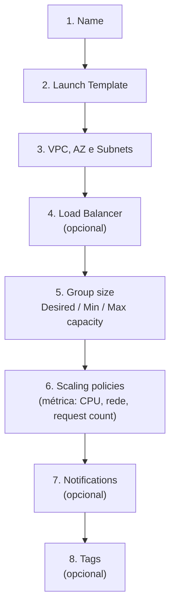
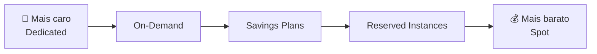
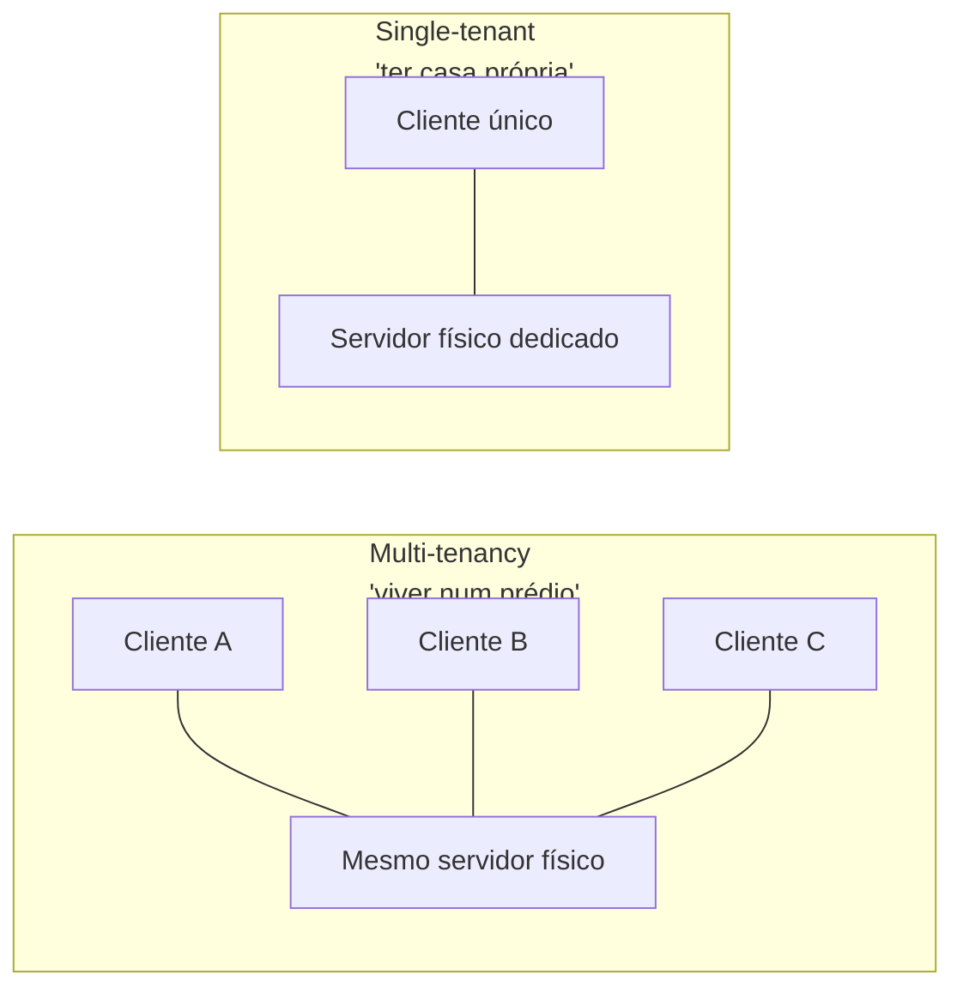
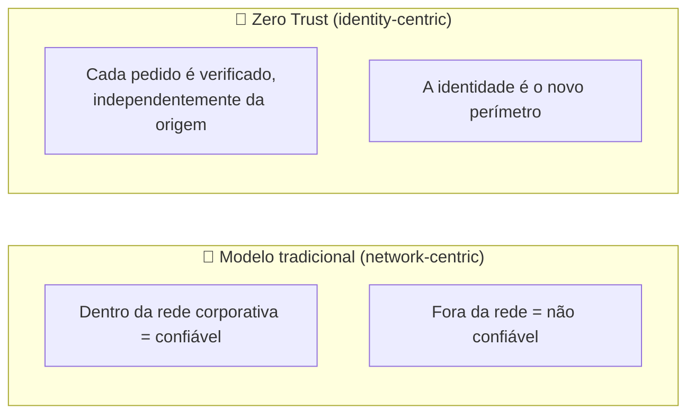
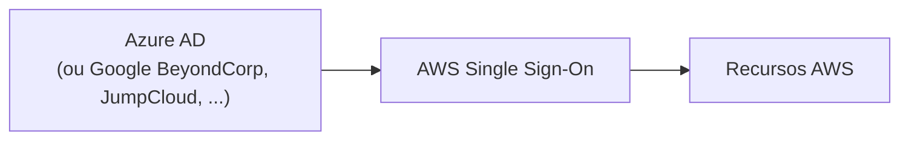
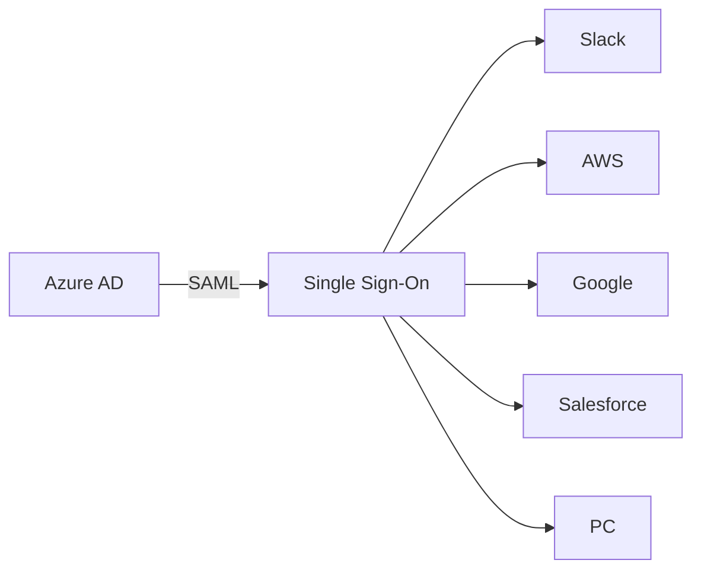

# Aula 8 — Auto Scaling, Pricing Models e Segurança de Identidade

# ⚖️ PARTE 1 — SCALING E LOAD BALANCING

## Auto Scaling Group (ASG) — passo a passo



| Campo | O que define |
|---|---|
| **Launch Template** | A "receita" usada para lançar cada nova instância (AMI, tipo, security group, etc.) |
| **VPC / AZ / Subnets** | Onde as instâncias vão ser lançadas |
| **Group size** | **Desired** (quantas queres agora), **Minimum** e **Maximum** capacity |
| **Scaling policies** | Regra que decide quando adicionar/remover instâncias, baseada numa métrica: uso de **CPU**, uso de **rede**, ou **request count per target** (via Application Load Balancer) |

### Health checks

O ASG verifica continuamente a saúde de cada servidor. Se uma instância falhar o health check:


---

## Elastic Load Balancer (ELB) — tipos

| Tipo | Quando usar |
|---|---|
| **Application Load Balancer (ALB)** | Conjunto flexível de funcionalidades para a tua app, tráfego **HTTP/HTTPS** |
| **Network Load Balancer (NLB)** | Quando precisas de **alta performance**, *TLS offloading* em escala, deployment centralizado de certificados, suporte a **UDP** e IP estático |
| **Gateway Load Balancer (GWLB)** | Quando precisas de implementar e gerir uma frota de appliances virtuais de terceiros que suportam o protocolo **GENEVE** |

### Configurar um Application Load Balancer

| Campo | Detalhe |
|---|---|
| Name | Nome do ALB |
| Scheme | **Internet-facing** (público) ou **Internal** (só dentro da VPC) |
| IPv4 | Endereçamento IP |
| VPC | A mesma VPC das instâncias |
| AZ | ⚠️ Escolher as **mesmas AZs** usadas no Auto Scaling Group |
| Security Group | Firewall do próprio load balancer |
| Listeners and routing | Define o **target group** — as máquinas (ou IPs estáticos) para onde o tráfego é encaminhado |

Depois de criado, o ALB é **associado ao ASG**, passando a distribuir o tráfego automaticamente pelas instâncias que o grupo gerir.

---

# 💰 PARTE 2 — MODELOS DE PRICING DO EC2

## Visão geral

| Modelo | Ideal para | Compromisso | Poupança |
|---|---|---|---|
| **On-Demand** | Curto prazo, picos, imprevisível, não pode ser interrompido | Nenhum | Menor |
| **Spot** | Jobs não-críticos, em background, tolerantes a interrupções | Nenhum, mas pode ser interrompido pela AWS | Maior (até 90%) |
| **Reserved (RI)** | Uso estável e previsível a longo prazo | 1 ou 3 anos | Alta a longo prazo |
| **Dedicated** | Precisas de hardware fisicamente isolado | Pode ser On-Demand, Reserved ou Spot | O mais caro |
| **Savings Plans** | Como o Reserved, mas mais simples e flexível | 1 ou 3 anos de compromisso de **gasto** (não de instância fixa) | Alta, com mais flexibilidade |



---

## On-Demand

Modelo **pay-as-you-go**: consomes compute e depois pagas.

- Sem pagamento adiantado, sem compromisso.
- Usa para workloads de **curto prazo**, com picos ou imprevisíveis.

---

## Reserved Instances (RI)

Desenhadas para aplicações com uso **estável e previsível**, ou que precisam de capacidade reservada.

> O desconto no preço depende de: **Term × Class × Atributos da RI × Opção de pagamento**

### Term (prazo de compromisso)

- Quantos anos de compromisso? **Mais anos = mais poupança** a longo prazo.
- ⚠️ Quando expira, é preciso **renovar**. Se não renovares, as instâncias passam a **On-Demand**, sem qualquer interrupção de serviço.

### Class (classe)

| Classe | Poupança | Flexibilidade |
|---|---|---|
| **Standard** | Até **75%** de redução de preço | Pode **modificar atributos** |
| **Convertible** | Até **54%** de redução de preço | Pode ser **trocada** (exchange) por outra RI, se o valor for igual ou superior |

> 📌 Regra geral: **quanto menos flexível, maior a poupança** — a Standard poupa mais, mas é mais rígida; a Convertible poupa menos, mas adapta-se a mudanças.

### Opções de pagamento

| Opção | Poupança |
|---|---|
| **All Upfront** | Maior poupança |
| **Partial Upfront** | Poupança intermédia |
| **No Upfront** | Menor poupança |

> 📌 Regra geral: **quanto maior o valor pago adiantado, maior a poupança**.

- As RIs podem ser **partilhadas entre várias contas** dentro de uma AWS Organization.
- RIs não usadas podem ser **vendidas no Reserved Instance Marketplace**.

---

## Atributos de uma RI

- **Instance type**
- **Region**
- **Tenancy**
- **Platform** (Windows ou Linux)

### Regional RI vs. Zonal RI

> Ao comprares uma RI, defines o **scope** (âmbito). O scope **não afeta o preço**.

| | **Regional RI** | **Zonal RI** |
|---|---|---|
| Comprada para | Uma **região** | Uma **Availability Zone** específica |
| Reserva capacidade? | ❌ Não reserva capacidade | ✅ Reserva capacidade na AZ especificada |
| Onde se aplica o desconto | Em **qualquer AZ** da região | Só na AZ selecionada (sem flexibilidade de AZ) |
| Flexibilidade de tamanho | Aplica-se à utilização dentro da família de instância, **independentemente do tamanho** (só em Amazon Linux/Unix, tenancy default) | **Sem** flexibilidade de tamanho — o desconto só se aplica ao tipo e tamanho exatos especificados |
| Compras em fila (queued) | ✅ Permite colocar compras em fila | — |

> 💡 Padrão para memorizar: **Regional = flexível, mas não garante capacidade. Zonal = garante capacidade, mas é rígida.**

### Limites de compra de RI

| Âmbito | Limite por mês |
|---|---|
| Regional RI | **20 por Região** |
| Zonal RI | **20 por AZ** |

| Tipo de limite | Regra |
|---|---|
| **Regional** | Não podes exceder o teu limite de instâncias On-Demand em execução, comprando RIs regionais. O limite por defeito de instâncias On-Demand é **20**. Antes de comprar RIs, confirma que o teu limite On-Demand é igual ou superior ao número de RIs que pretendes comprar |
| **Zonal** | **Podes exceder** o teu limite de instâncias On-Demand comprando RIs zonais. Exemplo: se já tens 20 instâncias On-Demand em execução e compras 20 RIs zonais, podes lançar mais 20 instâncias On-Demand que correspondam às especificações dessas RIs zonais |

---

## Standard RI vs. Convertible RI

| | **Standard RI** | **Convertible RI** |
|---|---|---|
| **Modificar atributos** | ✅ Sim — pode alterar a AZ dentro da mesma região, mudar o scope (Zonal ↔ Regional), mudar o tamanho da instância (só Linux/Unix, tenancy default), mudar a rede (EC2-Classic ↔ VPC) | ❌ Não pode ser modificada — em vez disso, faz-se uma **troca (exchange)** |
| **Exchange (troca)** | ❌ Não pode ser trocada | ✅ Pode ser trocada durante o termo por outra Convertible RI com novos atributos: **família de instância, tipo, plataforma, scope, tenancy** |
| **RI Marketplace** | ✅ Pode ser comprada/vendida | ❌ Não pode ser comprada/vendida |

---

## RI Marketplace — regras principais

- Só podes vender uma RI depois de estar ativa durante, no mínimo, **30 dias**, e depois de a AWS ter recebido o pagamento adiantado (se aplicável).
- É preciso ter uma **conta bancária dos EUA** para vender RIs no marketplace.
- Tem de restar **pelo menos 1 mês** no termo da RI que estás a vender.
- Mantens o preço e o benefício de capacidade da reserva **até à venda ser concluída**.
- O nome da tua empresa (e morada, se pedido) é partilhado com o comprador, para fins fiscais.
- Só podes definir o **preço adiantado (upfront)** — o preço de utilização e a restante configuração (tipo de instância, AZ, plataforma) mantêm-se iguais à compra original.
- A duração do termo é **arredondada para baixo** ao mês mais próximo (ex.: 9 meses e 15 dias aparece como 9 meses).
- Podes vender até **$20.000** em RIs por ano. Para vender mais, é preciso pedir um aumento.
- RIs na região **GovCloud não podem ser vendidas** no marketplace.

---

## Capacity Reservations

As instâncias EC2 correm em hardware físico finito — por vezes, ao tentares lançar um tipo específico de instância, a **AWS pode não ter capacidade disponível** nesse momento.

> **Capacity Reservations:** serviço que te permite reservar capacidade de EC2 para uma região e AZ específicas, garantindo que o hardware estará disponível quando precisares.

---

## Spot Instances

Capacidade de computação não utilizada, que a AWS quer rentabilizar (como um avião a oferecer descontos para preencher lugares vagos).

- Até **90% de desconto** face ao preço On-Demand.
- Desenhadas para apps com horários de início/fim **flexíveis**, ou que só são viáveis a custos de computação muito baixos.
- **AWS Batch** é uma forma fácil e conveniente de usar preços Spot.

| Situação | É cobrado? |
|---|---|
| A AWS termina a instância | ❌ Não pagas a hora parcial de utilização |
| Tu terminas a instância | ✅ Continuas a ser cobrado |

> ⚠️ As instâncias Spot podem ser **terminadas pela AWS a qualquer momento** — nunca uses para workloads críticos.

---

## Dedicated Instances e Dedicated Hosts

Úteis quando precisas de cumprir **requisitos regulatórios**, ou quando tens licenciamento de software ligado a hardware físico específico que não suporta multi-tenancy nem deployments em cloud partilhada.



| Modelo | Isolamento | Analogia |
|---|---|---|
| **Multi-tenancy** | Virtual — vários clientes correm workloads no mesmo servidor físico | Viver num prédio: vários inquilinos, paredes a separar |
| **Single-tenant** | Físico — um servidor dedicado a um único cliente | Ter casa própria: só tu nesse edifício |

> A **tenancy** escolhe-se no momento em que lanças a instância EC2.

---

## Savings Plans

Descontos semelhantes às Reserved Instances, mas com um processo de compra **mais simples**: em vez de reservares um tipo de instância específico, comprometes-te a um **valor de gasto por hora**.

| Tipo | Poupança | Flexibilidade |
|---|---|---|
| **Compute Savings Plans** | Até **66%** | Máxima flexibilidade — aplica-se automaticamente a EC2, AWS Fargate e AWS Lambda, independentemente da família de instância, tamanho, AZ, SO ou tenancy |
| **EC2 Instance Savings Plans** | Até **72%** | Preços mais baixos, mas o compromisso é para o uso de uma **família de instância específica** |
| **SageMaker Savings Plans** | Até **64%** | Aplica-se automaticamente ao uso do SageMaker, independentemente da família de instância, tamanho, componente ou região |

**Termos e pagamento:** iguais às RIs — **1 ou 3 anos**, com opções **All Upfront / Partial Upfront / No Upfront**.

---

# 🔐 PARTE 3 — ZERO TRUST E GESTÃO DE IDENTIDADE

## O que é o Zero Trust Model

> Princípio: **"não confies em ninguém, verifica tudo"** ("trust no one, verify everything").

A **identidade** passa a ser o principal perímetro de segurança — em vez de proteger "a rede" como um todo, protege-se e controla-se o acesso aos **dados e recursos** da empresa, verificando sempre quem está a pedir acesso, independentemente de onde vem o pedido.



| Abordagem | Onde está o "perímetro" |
|---|---|
| **Network-centric** (tradicional) | A rede — se estás "dentro", és confiável |
| **Identity-centric** (Zero Trust) | A identidade — cada pedido é verificado, mesmo vindo de dentro |

### Zero Trust na AWS

| Serviço | Papel no Zero Trust |
|---|---|
| **AWS IAM** | IAM policies, permissions boundaries, service control policies (SCPs), e condições em políticas IAM (restringir por IP, região, se o MFA está desligado, hora do dia) |
| **AWS CloudTrail** | Regista (audita) **todas** as chamadas à API feitas na conta |
| **Amazon GuardDuty** | Deteta atividade suspeita ou maliciosa, com base nos logs do CloudTrail e outras fontes |
| **Amazon Detective** | Analisa, investiga e identifica rapidamente problemas de segurança — pode consumir os *findings* do GuardDuty |

> ⚠️ **Nota importante:** a AWS não tem, de raiz, controlos de identidade "inteligentes" prontos a usar — por isso considera-se que a AWS **não tem, por si só, uma verdadeira oferta Zero Trust completa**. Normalmente são usados serviços e identity providers **de terceiros** em conjunto com a AWS para atingir um modelo Zero Trust completo.

### Zero Trust na AWS com terceiros

O **Azure Active Directory** (e outros, como o **Google BeyondCorp** ou o **JumpCloud**) consegue deteção de risco em **tempo real e calculada**, com base em mais pontos de dados do que a AWS sozinha: dispositivo e app usados, hora do dia, localização, se o MFA está ativo, e o que está a ser acedido.



---

## Directory Service

Componente crítico de um sistema operativo de rede: **mapeia nomes de recursos de rede para os respetivos endereços de rede**.

> É uma infraestrutura de informação partilhada para localizar, gerir, administrar e organizar recursos: volumes, pastas, ficheiros, impressoras, utilizadores, grupos, dispositivos, etc.

| Exemplo | Descrição |
|---|---|
| **DNS** | O "directory service" da internet |
| **Microsoft Active Directory** / **Azure Active Directory** | Directory service corporativo da Microsoft |
| **Apache Directory Server** | Implementação open-source |
| **OpenLDAP** | Implementação open-source do protocolo LDAP |

### Active Directory

A Microsoft introduziu o **Active Directory Domain Services** no Windows 2000: permite gerir múltiplos componentes e sistemas de infraestrutura **on-premise**, usando **uma única identidade por utilizador**.

---

## Identity Providers (IdPs)

> Entidade de sistema que cria, mantém e gere informação de identidade de principais (utilizadores), e também fornece serviços de autenticação a aplicações dentro de uma federação ou rede distribuída.

**Exemplos:** Facebook, Amazon, Google, Twitter, GitHub, LinkedIn.

### Federated Identity (Identidade Federada)

Método que permite **ligar a identidade de um utilizador entre múltiplos sistemas de gestão de identidade separados** — ou seja, usar a mesma conta (ex.: Google) para entrar em vários sistemas diferentes.

### Protocolos de autenticação/federação

| Protocolo | Tipo | Como funciona |
|---|---|---|
| **OpenID** | Protocolo de **autenticação** | Permite fazer login numa plataforma diferente usando, por exemplo, uma conta Google |
| **OAuth 2.0** | Protocolo de **autorização** | Não partilha dados de password — usa **tokens de autorização** para provar uma identidade entre o consumidor e o fornecedor do serviço |
| **SAML** | Protocolo de **Single Sign-On** | SSO feito via browser web |

---

## Single Sign-On (SSO)

Permite que um utilizador entre com **um único ID e password** em vários sistemas e aplicações diferentes.



> Fazes login no teu **diretório principal** uma única vez, e consegues entrar em múltiplas plataformas **sem introduzir as credenciais novamente** em cada uma.

---

## LDAP (Lightweight Directory Access Protocol)

Protocolo de aplicação para aceder e manter serviços de informação de diretório distribuída, via Internet Protocol (IP).

- **Permite o "mesmo" sign-on** (same sign-on): o utilizador usa um único ID e password, mas tem de o **introduzir de cada vez** que quer entrar (ao contrário do SSO verdadeiro, onde só entras uma vez).

```
on-premise AD → LDAP → Google, Kubernetes, Jenkins
```

> 📝 Exemplo prático dado na aula: usado numa firewall empresarial — para ligar à VPN, configurava-se o utilizador no portal da Fortinet, usando o mesmo login/password para entrar na VPN.

### SSO vs. LDAP — a diferença chave

| | **SSO** | **LDAP (same sign-on)** |
|---|---|---|
| Nº de vezes que introduzes a password | **Uma vez** por sessão, para todos os sistemas | **De cada vez** que entras num sistema, embora a password seja sempre a mesma |
| Experiência do utilizador | Mais fluida — não vês ecrã de login repetido | Vês sempre o ecrã de login, mas usas sempre as mesmas credenciais |

---

## MFA (Multi-Factor Authentication)

Controlo de segurança em que, além de username/email e password, tens de usar um **segundo dispositivo** (ex.: telemóvel) para confirmar que és mesmo tu.

- Protege contra quem **roubou a tua password**, mas não tem o segundo fator.
- Exemplo: **Google Authenticator**.
- ⚠️ É **muito importante** ativar MFA em todas as contas AWS, especialmente na **conta root**.

## Security Keys

Dispositivo secundário usado como segundo passo no processo de autenticação, para aceder a um dispositivo, app ou posto de trabalho.

> Exemplo: **YubiKey** — chave física onde colocas o dedo (ou inseres numa porta USB/NFC) para autenticar.

---

📺 *Progresso: 8h16min de vídeo assistido.*