# Aula 9 — IAM Avançado, Application Integration, Containers e Governança

# 🔐 PARTE 1 — IAM EM DETALHE

## As três identidades do IAM

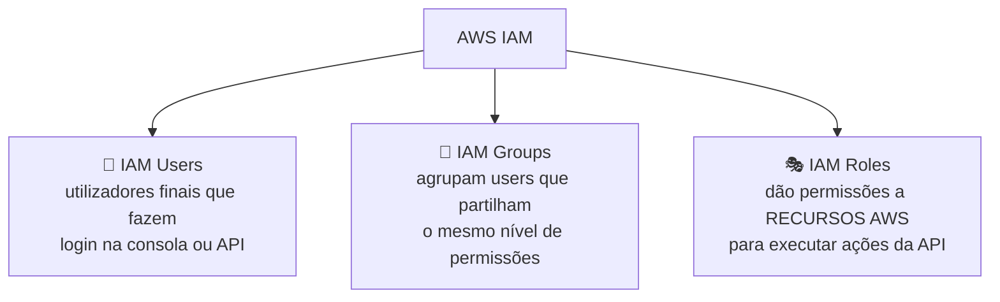

| Identidade | O que é | Exemplo |
|---|---|---|
| **IAM User** | Utilizador final que entra na consola ou interage com recursos AWS | A tua própria conta de trabalho |
| **IAM Group** | Conjunto de users que partilham o mesmo nível de permissões | Grupo "Developers" com acesso a EC2 e S3 |
| **IAM Role** | Dá a um **recurso AWS** (não a uma pessoa) permissão para executar ações específicas da API. Associas uma policy a uma role e atribuis essa role ao recurso | Uma EC2 com uma role que lhe permite **ler** de um bucket S3 específico |

## Anatomia de uma IAM Policy

- **IAM Policies:** documentos **JSON** que concedem permissões a um user, group ou role específicos, para acederem a serviços. São anexadas a identidades IAM.
- **IAM Permissions:** as ações da API que podem (ou não) ser executadas — são representadas dentro do documento da policy.

> Uma policy é, no fundo, uma lista de **"o que esta identidade pode ou não fazer"**, escrita em JSON.

---

## Princípio do Menor Privilégio (Least Privilege)

Conceito de segurança informática: atribuir a um user, role ou app **apenas** as permissões mínimas necessárias para executar a sua função.

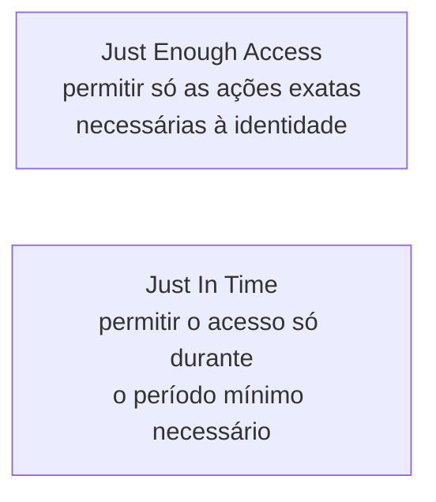

| Conceito | Significado |
|---|---|
| **Just Enough Access** | Permitir apenas as ações exatas que a identidade precisa — nada a mais |
| **Just In Time** | Permitir o acesso apenas durante o tempo mínimo necessário, não permanentemente |
| **Risk-Based Adaptive Policies** | Cada tentativa de acesso a um recurso gera uma **pontuação de risco**, com base em fatores como dispositivo, localização, IP, serviço acedido e horário |

> ⚠️ **Importante:** a AWS **não tem** políticas adaptativas baseadas em risco incorporadas de raiz no IAM — este tipo de funcionalidade normalmente vem de ferramentas de terceiros (ligação direta ao que vimos na Aula 8 sobre Zero Trust).

---

## Conta Root vs. Utilizador IAM

| | **AWS Account Root User** | **AWS Account User (IAM)** |
|---|---|---|
| Acesso | Total, a todos os serviços e recursos — **não pode ser limitado** por policies IAM | Definido pelas policies IAM atribuídas |
| Quantidade | **Só pode haver um** por conta AWS; não pode ser apagado | Tantos quantos forem necessários |
| Login | Email + password | Account ID + username + password |

### Ações que **só** a conta root pode executar

- Alterar definições da conta: nome, email, password do root
- Restaurar permissões de um utilizador IAM
- Ativar acesso IAM à consola de Billing and Cost Management
- Ver determinadas faturas fiscais
- Fechar a conta AWS
- Alterar ou cancelar o plano de suporte AWS
- Ativar o **MFA Delete** num bucket S3

> 🔒 Recomendação forte: **nunca** usar access keys da conta root, e ativar sempre **MFA** no root.

---

## AWS IAM Identity Center

> Antigo **AWS Single Sign-On**: crias ou ligas as identidades da tua força de trabalho à AWS **uma vez**, e geres o acesso de forma **centralizada** em toda a tua AWS Organization.

---

# 🔗 PARTE 2 — APPLICATION INTEGRATION

**Application Integration:** processo de permitir que duas aplicações independentes comuniquem e trabalhem em conjunto.

## Os três padrões de comunicação

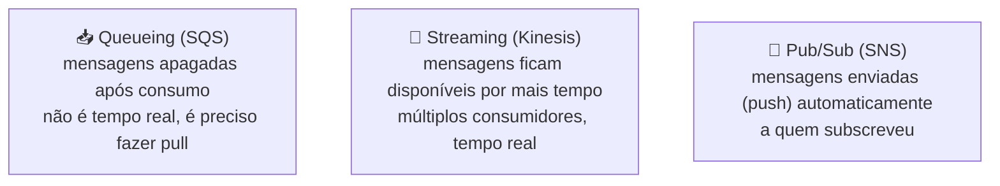

| Padrão | Como funciona | Serviço AWS |
|---|---|---|
| **Queueing** | Sistema de mensagens simples; as mensagens são **apagadas** depois de consumidas. Não é tempo real — é preciso **fazer pull** (ir buscar) | Amazon SQS |
| **Streaming** | As mensagens/eventos ficam disponíveis na stream durante **mais tempo**, permitindo operações complexas. **Múltiplos** consumidores podem reagir. Tempo real | Amazon Kinesis |
| **Pub/Sub** | O publicador não sabe quem são os subscritores. As mensagens são **automaticamente enviadas (push)** a quem subscreveu — não há pull | Amazon SNS |

---

### Amazon SQS (Simple Queue Service)

Serviço de queueing **totalmente gerido**, que permite desacoplar e escalar microservices, sistemas distribuídos e aplicações serverless.

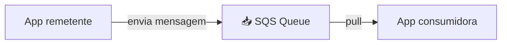

---

### Amazon Kinesis

Solução totalmente gerida para **recolher, processar e analisar** dados em streaming na cloud.

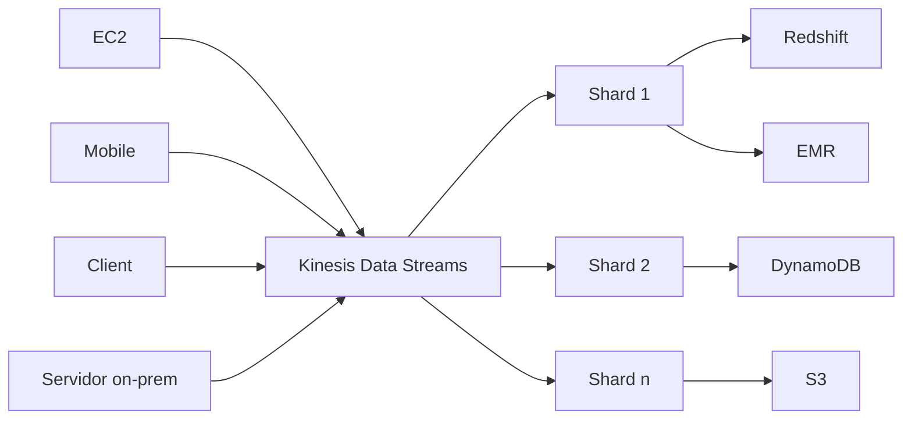

---

### Amazon SNS (Simple Notification Service)

Serviço de mensagens **pub/sub** da AWS.

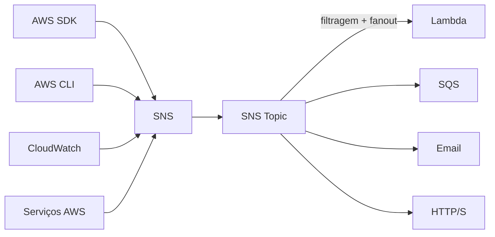

> Formatos de entrega suportados: texto simples, email, HTTP (webhooks), SMS (mensagens de texto), SQS e Lambda.

---

### Amazon API Gateway

Programa que se posiciona entre **um único ponto de entrada** e **múltiplos backends** — permite throttling, logging, lógica de routing, e formatação de pedidos/respostas.

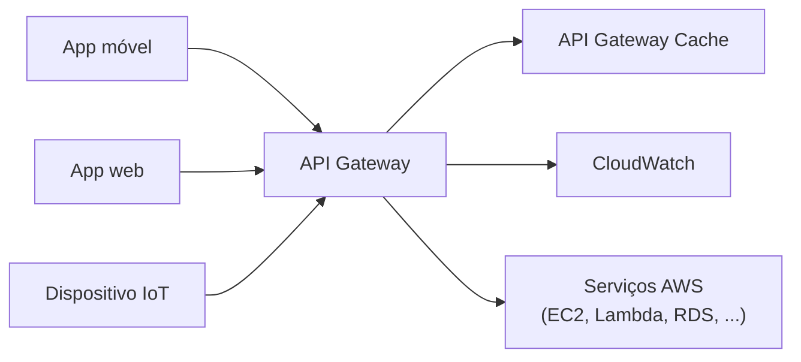

> **Amazon API Gateway:** cria APIs seguras no teu ambiente cloud, a qualquer escala.

---

### Máquinas de Estado e AWS Step Functions

**State machine:** decide como se passa de um estado para outro, com base numa série de condições — como um fluxograma.

> **AWS Step Functions:** coordena múltiplos serviços AWS num workflow **serverless**. Tem uma consola gráfica para visualizar os componentes, aciona e acompanha automaticamente cada passo, faz **retry** em caso de erro, e regista (log) o estado de cada passo.

---

### Event Bus e Amazon EventBridge

**Event bus:** recebe eventos e encaminha-os para um alvo (target), com base em regras.

> **Amazon EventBridge** (antigo CloudWatch Events): serviço de event bus **serverless**, usado para integração de aplicações através de streaming de dados em tempo real.

---

## Resumo: Serviços de Application Integration

| Serviço | Tipo | Descrição |
|---|---|---|
| **SNS** | Pub/Sub | Vários formatos de entrega: texto, email, HTTP (webhooks), SMS, SQS, Lambda |
| **SQS** | Queueing | Envia eventos para uma fila; outras apps fazem pull da fila para obter mensagens |
| **Step Functions** | State machine | Serviço de máquina de estados para orquestrar workflows |
| **EventBridge** | Event bus | Event bus serverless |
| **Kinesis** | Streaming | Dados em streaming em tempo real, com múltiplos consumidores |
| **Amazon MQ** | Message broker | Serviço de message broker gerido, usa **Apache ActiveMQ** |
| **Managed Kafka (MSK)** | Message broker | Apache Kafka totalmente gerido |
| **API Gateway** | API management | Criar, publicar, manter, monitorizar e proteger APIs |
| **AppSync** | GraphQL | Serviço GraphQL totalmente gerido |

---

## AWS Amplify

Framework **opinativo** e infraestrutura totalmente gerida, para os developers se focarem em construir apps web e mobile.

| Componente | Função |
|---|---|
| **Amplify CLI** | Linha de comandos para provisionar recursos |
| **Amplify SDK** | Biblioteca para integrar a app com os serviços AWS |
| **Amplify UI** | Componentes de interface prontos a usar |
| **Amplify Hosting** | Hospedagem da aplicação |
| **Amplify Studio** | Interface visual para gerir o backend |

> Funciona com frameworks JavaScript.

## AWS AppSync

Serviço **GraphQL totalmente gerido**.

| Conceito | Descrição |
|---|---|
| **Schema** | Representa o teu modelo de dados |
| **Data sources** | De onde os dados são obtidos: DynamoDB, Amazon OpenSearch, AWS Lambda, endpoint HTTP, etc. |
| **Resolvers** | Anexados a campos específicos dentro dos teus tipos no schema — implementam as operações de alteração de estado para query, mutation e subscription |

- Suporta **APIs em tempo real** via GraphQL subscriptions.

| Tipo de API | Descrição |
|---|---|
| **GraphQL API** | Uma única API a partir de múltiplas fontes de dados |
| **Merged API** | Coleção de GraphQL APIs que funcionam como uma só — útil quando várias equipas gerem as suas próprias APIs, mas queres tratá-las como uma API única |

**Opções de caching:** nenhuma / caching completo do pedido / caching por resolver (operações ou campos específicos).

---

# 🐳 PARTE 3 — VMs vs. Containers (explicado em detalhe)

## O problema das VMs

Numa **máquina virtual**, cada app corre isolada num SO convidado completo, por cima de um **hypervisor**. Isto tem um custo:

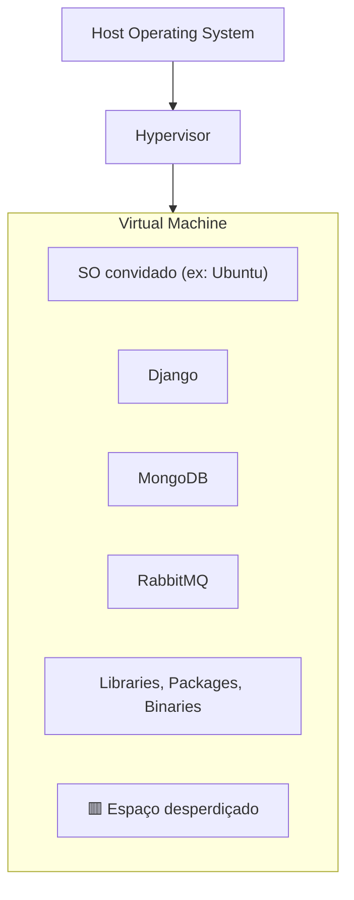

- As VMs **não fazem o melhor uso do espaço**.
- As apps **não estão isoladas entre si** dentro da mesma VM — podem gerar **conflitos de configuração**, **problemas de segurança** ou **monopolização de recursos** (resource hogging) por uma app em detrimento das outras.

## A solução: Containers

Um **container** empacota a aplicação com tudo o que ela precisa para correr (bibliotecas, dependências), mas **partilha o kernel do sistema operativo do host**, em vez de ter o seu próprio SO completo.

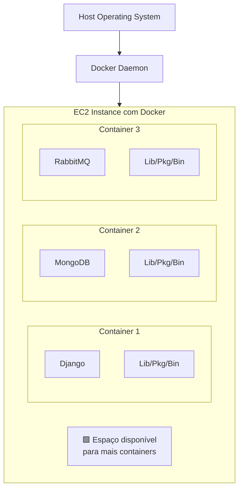

- Os containers permitem correr **múltiplas aplicações**, virtualmente **isoladas** umas das outras.
- Podes **lançar novos containers** e configurar as dependências do SO **por container**, sem desperdiçar o espaço que sobra, como acontecia com as VMs.

## Comparação direta

| | **Máquina Virtual (VM)** | **Container** |
|---|---|---|
| Camada de virtualização | **Hypervisor** | **Container Engine** (ex.: Docker Daemon) |
| O que cada unidade tem | O seu **próprio SO completo** | Partilha o **kernel do SO** do host |
| Peso/arranque | Mais pesado, arranque mais lento (minutos) | Muito mais leve, arranque quase instantâneo (segundos) |
| Isolamento | Isolamento forte (ao nível do SO) | Isolamento mais leve (ao nível de processo) |
| Uso de espaço | Tende a desperdiçar recursos reservados e não usados | Aproveita melhor o espaço disponível na mesma instância |
| Melhor para | Correr sistemas operativos completamente diferentes na mesma máquina física | Empacotar e distribuir aplicações de forma consistente e portátil |

> 📌 Resumo mental: **VM = virtualizas o hardware** (cada VM pensa que tem o seu próprio computador). **Container = virtualizas o sistema operativo** (cada container pensa que tem o seu próprio SO, mas todos partilham o mesmo kernel por baixo).

---

# 🧩 PARTE 4 — Microservices (explicado em detalhe)

## Arquitetura Monolítica vs. Microservices

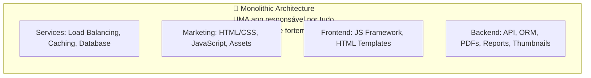

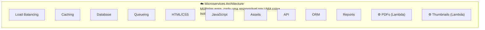

| | **Monolito** | **Microservices** |
|---|---|---|
| Nº de aplicações | **Uma só**, responsável por tudo | **Várias**, cada uma responsável por **uma coisa** |
| Acoplamento | **Fortemente acoplado** — tudo depende de tudo | **Isolado e stateless** — cada serviço é independente |
| Deploy | Deploy de **tudo de uma vez**, mesmo para uma mudança pequena | Deploy **independente** de cada serviço |
| Escalar | Escalas **a aplicação inteira**, mesmo que só uma parte precise | Escalas **só o serviço** que precisa (ex.: só o serviço de "Thumbnails") |
| Falha | Uma falha pode **derrubar toda a aplicação** | Uma falha fica **contida** nesse serviço específico |
| Tecnologia | Normalmente uma **stack única** para tudo | Cada serviço pode usar a **tecnologia mais adequada** (ex.: PDFs e Thumbnails como funções Lambda) |
| Complexidade operacional | Mais simples de gerir no início | Mais complexa — precisas de orquestração, service discovery, monitorização distribuída |

**Vantagens dos microservices:** escalabilidade seletiva, resiliência a falhas localizadas, equipas podem trabalhar e fazer deploy **independentemente** em cada serviço, liberdade tecnológica por serviço.

**Desvantagens:** maior complexidade de infraestrutura (rede, comunicação entre serviços), mais difícil de testar de ponta a ponta, exige ferramentas de orquestração (é aqui que entra o **Kubernetes**, a seguir).

---

# ⚙️ PARTE 5 — Kubernetes (K8s)

Sistema de orquestração de containers **open-source**, para automatizar o **deployment, scaling e gestão** de containers.

- Criado originalmente pela **Google**, atualmente mantido pela **Cloud Native Computing Foundation (CNCF)**.
- Chamado habitualmente de **"K8s"**: o "8" representa as letras restantes de "u**bernete**s".
- Vantagem sobre o Docker sozinho: permite correr containers **distribuídos por várias VMs**.

## Arquitetura do Kubernetes

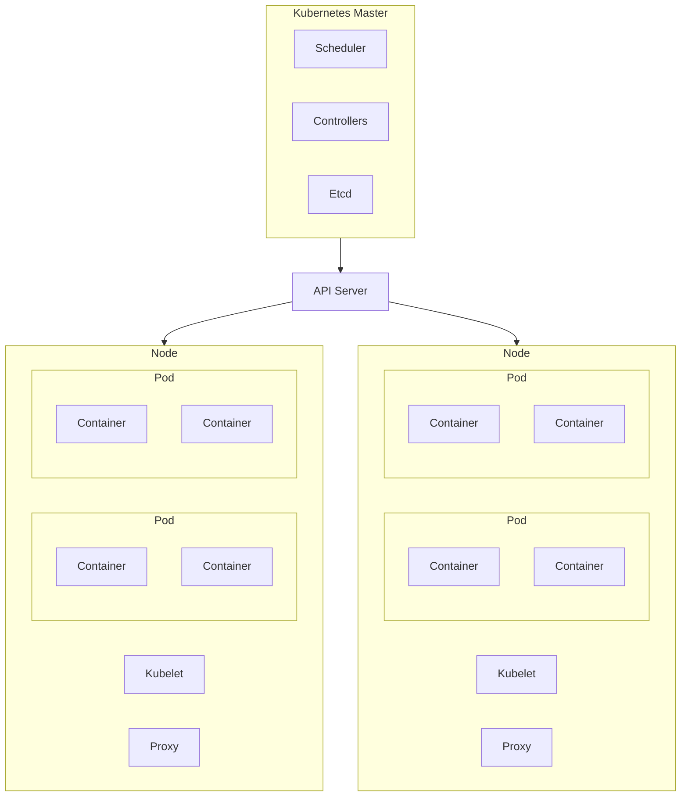

| Componente | Função |
|---|---|
| **Scheduler** | Decide em que node cada pod vai correr |
| **Controllers** | Garantem que o estado atual do cluster corresponde ao estado desejado |
| **Etcd** | Base de dados chave-valor que guarda o estado do cluster |
| **API Server** | Ponto de entrada para todos os comandos ao cluster |
| **Node** | Uma máquina (VM ou física) que corre pods |
| **Kubelet** | Agente que corre em cada node, garante que os containers dos pods estão a correr |
| **Proxy** | Gere as regras de rede em cada node |
| **Pod** | Grupo de **um ou mais containers** com storage, recursos de rede e outras configurações **partilhadas** — é a unidade mais pequena que se pode gerir no Kubernetes |

> 📌 O Kubernetes é ideal para arquiteturas de **microservices**, onde uma empresa tem dezenas a centenas de serviços para gerir — exatamente o cenário descrito na Parte 4.

---

# 🐋 PARTE 6 — Docker e Podman

## Docker

Produto que usa virtualização ao nível do SO para entregar software em pacotes chamados **containers**.

| Componente | Função |
|---|---|
| **Docker CLI** | Descarregar, enviar, construir, correr e debugar containers |
| **Dockerfile** | Ficheiro de configuração com as instruções para provisionar um container |
| **Docker Compose** | Ferramenta + ficheiro de configuração para trabalhar com **múltiplos** containers |
| **Docker Swarm** | Ferramenta de orquestração para gerir arquiteturas de múltiplos containers em produção |
| **Docker Hub** | Repositório online público de containers, publicados pela comunidade, para download |

## Podman

Motor de containers compatível com **OCI** (Open Container Initiative), pensado como substituto direto ("drop-in replacement") do Docker.

| Diferença | Docker | Podman |
|---|---|---|
| Arquitetura | Usa um **daemon** (`containerd`) | **Sem daemon** |
| Suporte a Pods | Não | **Sim** — tal como o Kubernetes |

> O Podman substitui apenas **parte** do que o Docker faz; costuma usar-se em conjunto com:
> - **Buildah** — para construir imagens OCI
> - **Skopeo** — para mover imagens de container entre diferentes tipos de storage

---

## Serviços de Containers na AWS

| Categoria | Serviços |
|---|---|
| **Primários (correm os containers)** | ECS, AWS Fargate, EKS, AWS Lambda |
| **Provisioning e deployment** | Elastic Beanstalk (EB), App Runner, AWS Copilot CLI |
| **Serviços de suporte** | Elastic Container Registry (imagens Docker), X-Ray, Step Functions |

---

# 🏢 PARTE 7 — Organizations, Control Tower e Governança

## AWS Organizations

Permite **criar novas contas AWS** e gerir centralmente **billing, controlo de acesso, compliance, segurança** e partilha de recursos entre contas.

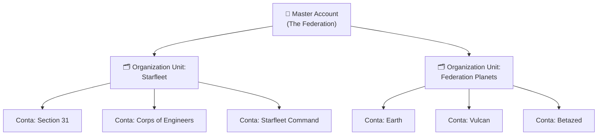

| Conceito | Descrição |
|---|---|
| **Root Account User** | Identidade de login única, com acesso completo a todos os serviços e recursos numa conta. Cada conta tem o seu Root Account User |
| **Organization Units (OUs)** | Grupos de contas AWS dentro de uma organização — podem conter **outras OUs**, criando uma hierarquia |
| **Service Control Policies (SCPs)** | Dão controlo **central** sobre as permissões máximas permitidas em todas as contas da organização, ajudando a garantir que as contas se mantêm dentro das regras da organização |

> ⚠️ O AWS Organizations, depois de **ativado, não pode ser desativado**. Podes criar quantas contas AWS quiseres — uma delas será sempre a conta **Master/Root** da organização.

---

## AWS Control Tower

Ajuda empresas a montar rapidamente um ambiente **multi-conta AWS seguro**, fornecendo um ambiente de base (*baseline*) para começar com uma arquitetura multi-conta.

| Componente | Descrição |
|---|---|
| **Landing Zone** | Ambiente de base: ativa o AWS SSO, logging centralizado via AWS CloudTrail, e auditoria de segurança entre contas |
| **Account Factory** | Automatiza o provisionamento de novas contas na organização, padronizando o processo |
| **Guardrails** | Regras de governança pré-empacotadas, para segurança, operações e compliance, que podes aplicar a toda a empresa ou a grupos específicos de contas |

---

## AWS Config

> **Change management:** ter um processo formal para **monitorizar, aplicar e corrigir** alterações.
> **Compliance as Code:** usar programação para automatizar a monitorização, aplicação e correção de alterações.

**AWS Config:** framework de compliance as code, que permite gerir alterações numa base **por região**.

### Quando usar o AWS Config?

- Queres que um recurso se mantenha configurado de uma forma específica, por motivos de compliance.
- Queres acompanhar alterações de configuração ao longo do tempo.
- Precisas de uma lista de **todos os recursos** existentes.
- Queres analisar potenciais fragilidades de segurança.

### Como funciona

Defines **regras** para detetar situações específicas, e um **plano de remediação** — se a regra for violada, o Config pode corrigir automaticamente (ou notificar alguém para o fazer).

**Exemplo — IAM Password Policy Conformance Pack:**
- Comprimento mínimo da password
- Exigir letras minúsculas
- Exigir números
- Idade máxima da password
- Exigir prevenção de reutilização
- Exigir letras maiúsculas
- Exigir símbolos

---

## Tagging (Etiquetagem)

Uma **tag** é um par chave-valor que atribuis a recursos AWS.

**Exemplos de tags:**

| Key | Value |
|---|---|
| `dept` | `it` |
| `status` | `approved` |
| `project` | `enterprise` |
| `location` | `london` |

### Porque organizar recursos com tags

- Gestão de recursos
- Gestão e otimização de custos
- Gestão de operações
- Segurança
- Governança e compliance regulatório
- Automação
- Otimização de workloads

## Resource Groups

Coleção de recursos que partilham uma ou mais tags. Aparecem no cabeçalho global da consola AWS, e também em **Systems Manager**.

---

# 🗺️ PARTE 8 — Cloud Adoption Framework (CAF)

Whitepaper da AWS para ajudar a **migrar de on-premise para a AWS**.

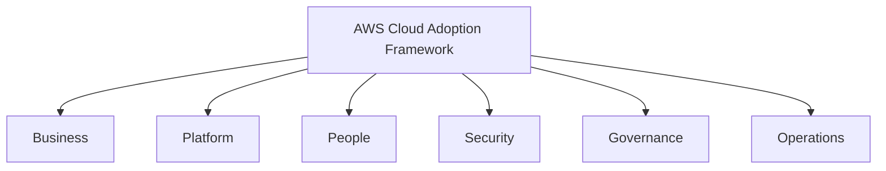

**6 áreas de foco:** Business, Platform, People, Security, Governance, Operations.

---

# 🏬 PARTE 9 — Serviços Orientados ao Negócio

| Serviço | Função |
|---|---|
| **Amazon Connect** | Serviço de call center virtual |
| **Amazon WorkSpaces** | Serviço de ambiente de trabalho remoto virtual |
| **Amazon WorkDocs** | Serviço de colaboração partilhada (semelhante ao SharePoint) |
| **Amazon Chime** | Serviço de videoconferência (semelhante ao Zoom) |
| **Amazon WorkMail** | Serviço gerido de email empresarial, contactos e calendário |
| **Amazon Pinpoint** | Gestão de campanhas de marketing — envio de emails/SMS direcionados |
| **Amazon SES** (Simple Email Service) | Serviço de email transacional, integrável nas tuas aplicações |
| **Amazon QuickSight** | Serviço de Business Intelligence (BI) |

---

# 🏗️ PARTE 10 — Serviços de Provisioning

> **Provisioning:** alocação ou criação de recursos e serviços para um cliente.

| Serviço | Função |
|---|---|
| **Elastic Beanstalk** | PaaS para fazer deploy de aplicações web facilmente |
| **AWS OpsWorks** | Serviço de configuration management, com instâncias geridas do **Chef** e **Puppet** (open-source) |
| **AWS CloudFormation** | Serviço de modelação e provisionamento de infraestrutura — automatiza o provisionamento ao escrever templates JSON/YAML (Infrastructure as Code) |
| **AWS Quick Start** | Pacotes pré-construídos para lançar e configurar rapidamente compute, rede, storage e outros serviços |
| **AWS Marketplace** | Catálogo digital de milhares de listagens de software de fornecedores independentes |
| **AWS Amplify** | Framework mobile e web que provisiona múltiplos serviços AWS como backend, com foco em serverless (DynamoDB, API Gateway, ...) |
| **AWS App Runner** | Facilita o deploy rápido de aplicações web e APIs containerizadas, a escala, sem experiência prévia de infraestrutura |
| **AWS Copilot** | CLI que permite lançar e gerir facilmente aplicações containerizadas na AWS |
| **AWS CodeStar** | Interface unificada para gerir atividades de desenvolvimento de software num único sítio |
| **AWS CDK** (Cloud Development Kit) | Ferramenta de IaC que permite usar a tua linguagem de programação preferida, gerando templates CloudFormation como mecanismo de IaC |

---

📺 *Progresso: 9h45min de vídeo assistido.*